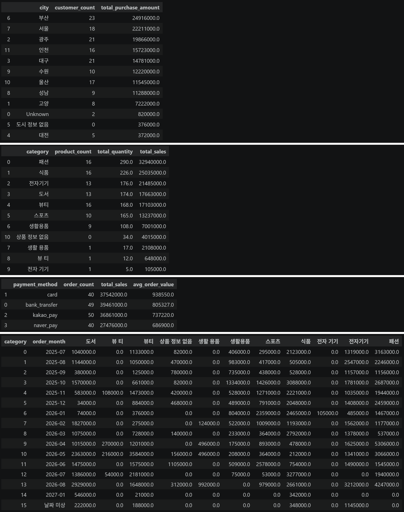
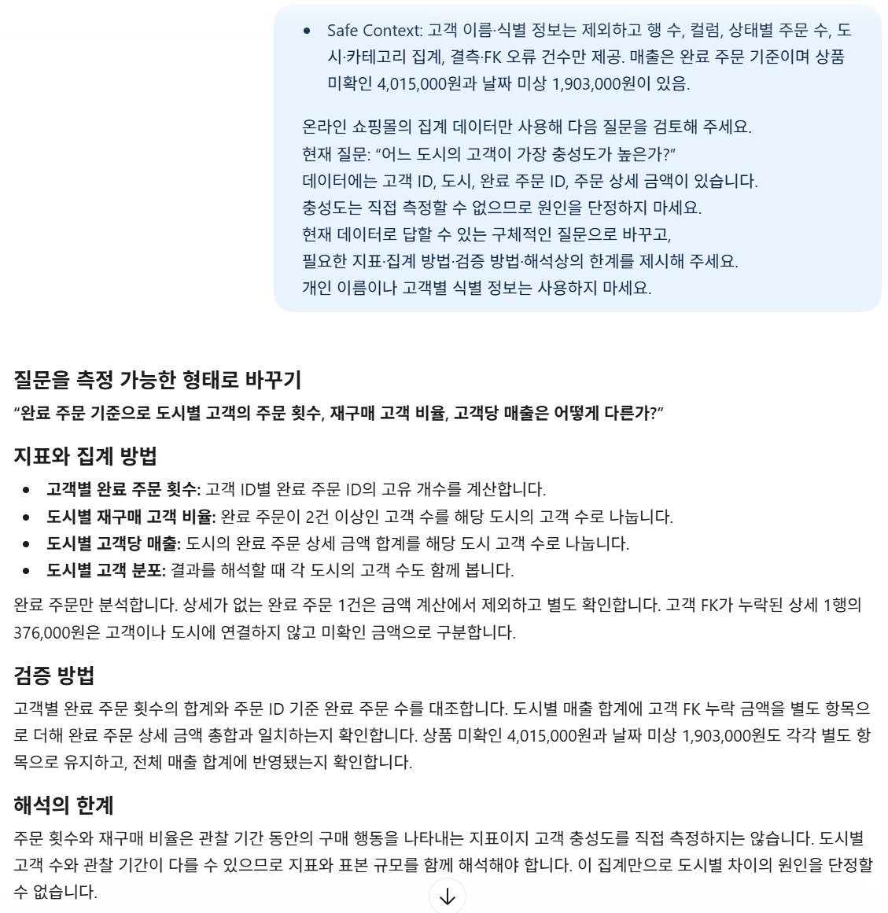

# Chapter 06 답안 양식. 데이터를 보며 질문을 만드는 EDA

> 이 내용을 `chapter06.ipynb`의 Markdown 셀로 작성합니다.

## 제출 정보
- 이름: `이경석`
- GitHub ID: `leeks2026`
- 작성일: `20261011`
- 최종 Notebook URL: `https://github.com/leeks2026/llm-data-analysis-study/blob/main/chapter06/chapter06.ipynb`

## 1. 내가 정한 EDA 질문
| 질문 | 분석 범위 | 지표 | 검증 방법 |
| --- | --- | --- | --- |
| 완료 주문 기준으로 도시별 고객 수와 구매 금액은 어떻게 다른가? | customers, orders, order_items | 도시별 고객 수, 완료 매출, 고객당 매출 | 주문 상세를 주문·고객에 연결하고 고객 FK 누락을 따로 표시해 합계 대조 |
| 상품 수가 많은 카테고리가 완료 주문 매출도 높은가? | products, order_items, orders | 원본 표기별 상품 수, 완료 매출, 매출 비중 | 완료 주문만 집계하고 상품 FK 누락을 별도 분류해 검증 |
| 결제수단별 평균 주문 금액과 월·카테고리별 매출은 어떻게 다른가? | orders, order_items, products | 주문 수, 평균 주문 금액, 월·카테고리 매출 | 주문별 상세 금액을 합산하고 날짜 미상 금액을 포함해 총액 대조 |

### 왜 이 질문을 선택했는가?

고객, 상품, 결제수단, 시간에 따른 차이를 현재 데이터로 계산해 다음 분석으로 연결할 수 있기 때문입니다. 매출은 `completed` 주문만 포함해 취소·환불 주문과 구분했습니다. 관찰한 차이만으로 원인을 단정하지 않도록 추가 검증 질문도 정했습니다.

## 2. 핵심 집계 결과
- completed 원본 합계: 완료 상태 주문의 주문 상세 446행에서 `line_total`을 합산한 금액은 **141,340,000원**입니다. 상세가 있는 완료 주문은 179건입니다. `orders_clean`의 완료 주문 180건 중 1건은 주문 상세가 없습니다.
- 카테고리별 합계: 원본 표기를 유지하고 상품 FK 누락을 별도 분류한 합계는 **141,340,000원**입니다.
- 월별 합계: 날짜가 확인되는 월 매출은 **139,437,000원**입니다. 완료 주문 상세 중 날짜 미상 6행의 **1,903,000원**을 포함하면 **141,340,000원**입니다.
- 총합 일치 여부: 상품 미확인과 날짜 미상 항목을 포함하면 카테고리 및 월별 합계가 완료 주문 상세 합계와 일치합니다.

### 결과 관찰

**도시별 고객 수와 완료 주문 구매 금액**

| 도시 | 고객 수 | 완료 주문 구매 금액 |
| --- | ---: | ---: |
| 부산 | 23 | 24,916,000원 |
| 서울 | 18 | 22,211,000원 |
| 광주 | 21 | 19,866,000원 |
| 인천 | 16 | 15,723,000원 |
| 대구 | 21 | 14,781,000원 |
| 수원 | 10 | 12,220,000원 |
| 울산 | 17 | 11,545,000원 |
| 성남 | 9 | 11,288,000원 |
| 고양 | 8 | 7,222,000원 |
| Unknown | 2 | 820,000원 |
| 대전 | 5 | 372,000원 |
| 도시 정보 없음 | 0 | 376,000원 |
| **합계** | **150** | **141,340,000원** |

부산은 고객 수와 매출이 가장 큽니다. 서울은 고객 1명당 구매 금액이 약 1,233,944원으로 부산의 약 1,083,304원보다 큽니다. 이 차이만으로 고객 성향을 단정할 수는 없습니다.

**상품 수와 완료 주문 카테고리 매출**

| 카테고리 원본 표기 | 상품 수 | 완료 주문 매출 | 매출 비중 |
| --- | ---: | ---: | ---: |
| 패션 | 16 | 32,940,000원 | 23.31% |
| 식품 | 16 | 25,035,000원 | 17.71% |
| 전자기기 | 13 | 21,485,000원 | 15.20% |
| 도서 | 13 | 17,663,000원 | 12.50% |
| 뷰티 | 16 | 17,103,000원 | 12.10% |
| 스포츠 | 10 | 13,237,000원 | 9.37% |
| 생활용품 | 9 | 7,001,000원 | 4.95% |
| 상품 미확인(FK 누락) | 0 | 4,015,000원 | 2.84% |
| 생활 용품 | 1 | 2,108,000원 | 1.49% |
| 뷰 티 | 1 | 648,000원 | 0.46% |
| 전자 기기 | 1 | 105,000원 | 0.07% |
| **합계** | **96** | **141,340,000원** | **100.00%** |

상품 수가 각각 16개인 패션·식품·뷰티 중 패션 매출이 가장 큽니다. 띄어쓰기만 다른 카테고리 표기는 원본 그대로 별도 집계했습니다. 상품 ID를 찾지 못한 완료 상세 16행의 4,015,000원은 상품 미확인으로 분류했습니다.

**결제수단별 완료 주문 평균 금액**

| 결제수단 | 주문 수(상세 확인 가능) | 완료 주문 매출 | 평균 주문 금액 |
| --- | ---: | ---: | ---: |
| card | 40 | 37,542,000원 | 938,550원 |
| bank_transfer | 49 | 39,461,000원 | 805,327원 |
| kakao_pay | 50 | 36,861,000원 | 737,220원 |
| naver_pay | 40 | 27,476,000원 | 686,900원 |
| **합계** | **179** | **141,340,000원** | — |

평균 주문 금액은 주문별 `line_total` 합계를 결제수단별 주문 수로 나눴습니다. 주문 상세가 없는 완료 주문 1건은 금액을 계산할 수 없어 제외했습니다.

**완료 주문 월별 매출**

| 월 | 완료 주문 매출 |
| --- | ---: |
| 2025-07 | 9,561,000원 |
| 2025-08 | 9,362,000원 |
| 2025-09 | 5,299,000원 |
| 2025-10 | 12,629,000원 |
| 2025-11 | 9,583,000원 |
| 2025-12 | 8,581,000원 |
| 2026-01 | 8,135,000원 |
| 2026-02 | 7,689,000원 |
| 2026-03 | 7,247,000원 |
| 2026-04 | 11,459,000원 |
| 2026-05 | 12,006,000원 |
| 2026-06 | 11,031,000원 |
| 2026-07 | 8,966,000원 |
| 2026-08 | 16,980,000원 |
| 2027-01 | 909,000원 |
| 날짜 미상 | 1,903,000원 |
| **합계** | **141,340,000원** |

월·카테고리 집계의 최대 조합은 2026년 4월 패션 5,306,000원입니다. 다음은 2026년 8월 패션 4,247,000원, 2026년 5월 뷰티 3,584,000원입니다. 월 매출은 2026년 8월이 가장 컸습니다.

### 나의 해석과 판단

고객 수가 많은 도시와 매출이 큰 도시가 대체로 겹치지만 고객당 금액은 다를 수 있습니다. 상품 수가 같아도 카테고리 매출은 다르게 나타났습니다. 결제수단별 평균 금액과 월·카테고리별 차이는 관찰 결과이며, 가격·판매량·고객 구성 중 무엇이 원인인지는 이 집계만으로 단정하지 않았습니다.

### 업무·분석적 의미

카테고리별 재고·판매 전략을 검토할 때 상품 수와 매출을 함께 볼 수 있습니다. 월별 매출은 판매 계획이나 프로모션 검토의 출발점이 될 수 있습니다. 실제 판단 전 상품 FK·날짜 누락을 확인하고 취소·환불 상태와 완료 주문을 구분해야 합니다.

### 한계와 추가 확인 사항

완료 주문 180건 중 1건에는 주문 상세가 없습니다. 고객 FK가 없는 완료 상세 1행의 376,000원은 도시 미확인으로 분류했습니다. 상품 FK가 없는 완료 상세 16행의 4,015,000원은 카테고리를 알 수 없습니다. 주문일 변환 실패 2건에 연결된 완료 상세 6행의 1,903,000원은 날짜 미상으로 집계했습니다. `뷰티`/`뷰 티`, `생활용품`/`생활 용품`, `전자기기`/`전자 기기`는 원본 표기가 달라 별도 카테고리로 남겼습니다.

노트북의 기본 카테고리·월별 매출 셀은 주문 상태를 `completed`로 제한하지 않습니다. 이 답안과 비교하려면 같은 완료 상태 필터를 적용해야 합니다. `chapter06.ipynb`의 22장 실습 과제 코드 셀 1~4를 작성하고 실행했습니다. 출력 결과를 전처리 CSV에서 계산한 집계와 대조했으며, 과제 1~4의 금액과 주문 수가 일치합니다.

## 3. 관찰 → 가설 → 추가 검증
### 사례 1
- 관찰: 부산은 고객 23명과 완료 매출 24,916,000원으로 도시 중 가장 큽니다. 서울은 고객 18명, 매출 22,211,000원이며 고객당 금액은 부산보다 큽니다.
- 가설: 서울의 고객당 매출 차이는 주문 빈도나 주문당 금액 차이에서 비롯됐을 수 있습니다.
- 추가 검증: 도시별 완료 주문 수와 고객별 주문 횟수·평균 주문 금액 분포를 비교하고, 고객 미확인 매출 376,000원의 원인을 확인합니다.

### 사례 2
- 관찰: 패션·식품·뷰티는 각각 상품 16개지만 완료 매출은 각각 32,940,000원, 25,035,000원, 17,103,000원입니다. 상품 FK가 없는 완료 상세 매출은 4,015,000원입니다.
- 가설: 매출 차이는 판매 수량, 실제 판매 단가, 상품 구성 차이와 관련이 있을 수 있습니다.
- 추가 검증: 상품 ID 누락을 원본과 대조하고 카테고리 표기를 확인한 뒤 판매 수량과 주문 단가 분포를 비교합니다.

### 사례 3
- 관찰: 상세 금액이 확인되는 완료 주문에서 카드 평균 주문 금액은 938,550원으로 가장 높고, 네이버페이는 686,900원으로 가장 낮습니다.
- 가설: 결제수단별 고객 구성이나 구매 상품 조합이 평균 금액 차이와 관련이 있을 수 있습니다.
- 추가 검증: 평균뿐 아니라 중앙값·금액 분포를 비교하고 주문별 상품 수와 카테고리 구성을 확인합니다. 상세가 없는 완료 주문 1건도 원본에서 확인합니다.

## 4. LLM 질문 확장
- Safe Context: 고객 이름·식별 정보는 제외하고 행 수, 컬럼, 상태별 주문 수, 도시·카테고리 집계, 결측·FK 오류 건수만 제공합니다. 매출은 완료 주문 기준이며 상품 미확인 4,015,000원과 날짜 미상 1,903,000원이 있음을 알립니다.
- Prompt:
  온라인 쇼핑몰의 집계 데이터만 사용해 다음 질문을 검토해 주세요.
  현재 질문: “어느 도시의 고객이 가장 충성도가 높은가?”
  데이터에는 고객 ID, 도시, 완료 주문 ID, 주문 상세 금액이 있습니다.
  충성도는 직접 측정할 수 없으므로 원인을 단정하지 마세요.
  현재 데이터로 답할 수 있는 구체적인 질문으로 바꾸고,
  필요한 지표·집계 방법·검증 방법·해석상의 한계를 제시해 주세요.
  개인 이름이나 고객별 식별 정보는 사용하지 마세요.

- LLM 제안 요약: “충성도”를 완료 주문 횟수, 재구매 고객 비율, 고객당 매출처럼 측정 가능한 질문으로 바꾸고 도시별 분포를 비교하자는 제안을 반영했습니다.
- 실제 사용 여부: 수정 후 사용
- 판단 이유: 현재 데이터로 계산 가능한 지표로 바꾸고 충성도나 매출 차이의 원인을 단정하지 않도록 조정했습니다.
- 사람이 수정한 내용: 분석을 완료 주문으로 한정하고 고객 FK 누락과 상세가 없는 완료 주문을 한계에 추가했습니다.

## 5. 다음 분석 우선순위
1. 상품 FK가 없는 주문 상세 26행을 원본과 대조하고, 완료 주문에 해당하는 16행의 4,015,000원을 확인합니다. 카테고리 띄어쓰기 변형도 데이터 소유자 기준으로 정리합니다.
2. 주문일 변환 실패 3건을 원문과 대조합니다. 완료 주문 2건에 연결된 상세 6행의 1,903,000원은 날짜 확인 전까지 날짜 미상으로 관리합니다.
3. 고객별 완료 주문 수와 평균 주문 금액으로 탐색적 세그먼트를 만듭니다. 반복 구매는 완료 주문 2건 이상, 고액 단발 구매는 완료 주문 1건이면서 단발 구매 고객 매출 상위 10%인 경우로 임시 정의해 분포를 확인합니다.

### 가장 먼저 확인하고 싶은 이유

FK와 날짜 문제를 먼저 정리해야 카테고리별·월별 합계의 누락 여부를 판단할 수 있습니다. 그다음 반복 구매와 주문 금액을 살펴야 고객 가치에 관한 해석을 구체화할 수 있습니다.

### 현재 데이터만으로 단정할 수 없는 것

월별 매출 증감의 원인, 카테고리 선호 이유, 결제수단 선택 이유, 도시별 충성도는 단정할 수 없습니다. 프로모션·유입 경로·상품 노출·반품 사유 등 추가 정보가 필요합니다. 날짜·FK 오류와 누락된 주문 상세를 확인하기 전까지 결과는 잠정적인 EDA 관찰로 봐야 합니다.

## 최종 체크
- [x] 질문과 지표가 연결되어 있습니다.
- [x] 집계 총합을 검증했습니다.
- [x] 관찰과 가설을 구분했습니다.
- [x] 다음 검증 질문을 작성했습니다.
- [x] LLM 제안을 검증했습니다.
- [x] 최종 Notebook URL을 제출합니다.
