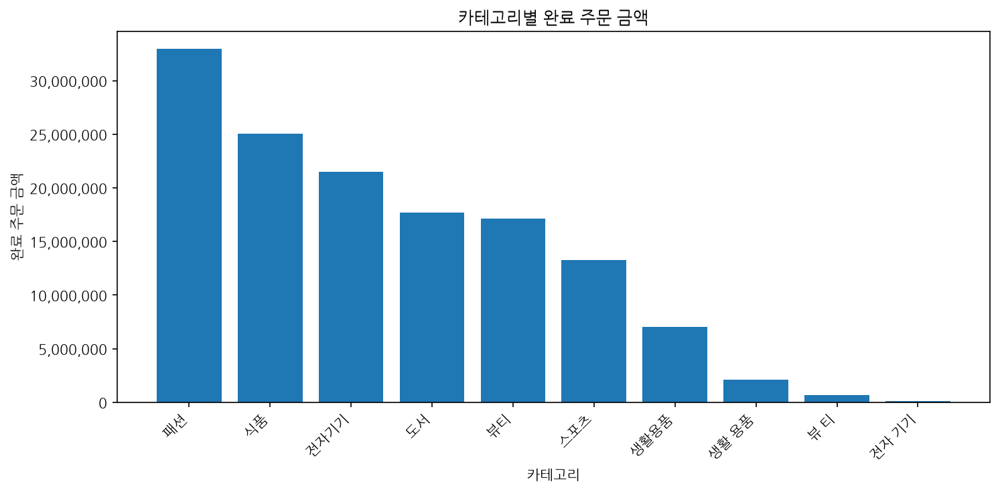
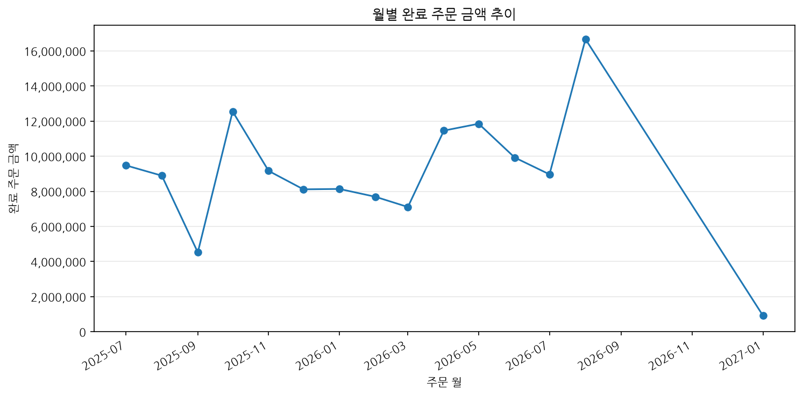
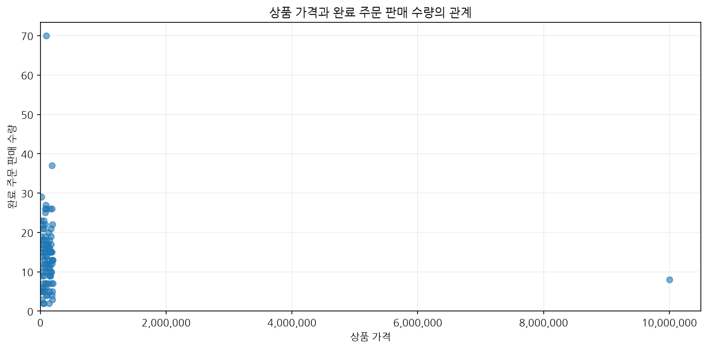

# Chapter 07 답안 양식. 그래프로 데이터의 이야기를 보여주기

> 이 내용을 `chapter07.ipynb`의 Markdown 셀로 작성합니다.

## 제출 정보
- 이름: `이경석`
- GitHub ID: `leeks2026`
- 작성일: `20261018`
- 최종 Notebook URL: `https://github.com/leeks2026/llm-data-analysis-study/blob/main/chapter07/chapter07.ipynb`

## 1. 시각화 질문과 그래프 선택
| 질문 | 선택한 그래프 | 선택 이유 |
| --- | --- | --- |
| 완료 주문 금액이 카테고리별로 어떻게 다른가? | 막대그래프 | 카테고리별 금액을 비교하기 쉽습니다. |
| 월별 완료 주문 금액은 어떻게 변하는가? | 선그래프 | 시간 순서에 따른 변화와 공백을 확인할 수 있습니다. |
| 상품 가격과 완료 판매 수량 사이에 어떤 관계가 관찰되는가? | 산점도 | 두 수치형 변수의 분포와 관계 후보를 확인할 수 있습니다. |

## 2. 대표 그래프 1

### 원본 집계값
카테고리별 완료 주문 금액 합계는 137,325,000원입니다. 집계표에서 패션 32,940,000원, 식품 25,035,000원, 전자기기 21,485,000원 순입니다.

### 결과 관찰
패션 금액이 가장 높습니다. 표기상 `뷰티`와 `뷰 티`, `생활용품`과 `생활 용품`, `전자기기`와 `전자 기기`가 각각 별도 범주로 집계되어 있습니다.

### 나의 해석과 판단
현재 그래프는 입력된 카테고리 문자열을 그대로 비교합니다. 공백 표기 차이가 실제로 같은 카테고리를 뜻하는지 확인하기 전에는 합산하지 않습니다.

### 업무·분석적 의미
카테고리 간 금액 비교와 후속 판매 수량·평균 단가 확인의 우선순위를 정할 수 있습니다.

### 한계와 추가 확인 사항
금액만으로 선호나 수익성을 단정할 수 없습니다. 카테고리 표기의 의미와 원문을 확인하고, 판매 수량·상품 수·할인·재고도 추가 확인해야 합니다.

## 3. 대표 그래프 2

### 원본 집계값
유효한 주문일이 있는 완료 주문 상세의 월별 금액 합계는 135,422,000원입니다. 2026년 8월은 16,668,000원, 15건, 평균 주문 금액 1,111,200원입니다. 다음 집계 월인 2027년 1월은 909,000원, 1건입니다.

### 결과 관찰
2026년 8월 금액이 가장 높습니다. 월별 집계표에는 2026년 9~12월이 없고, 다음 기록은 2027년 1월입니다. 날짜가 결측된 완료 주문 상세 6행은 월별 집계에서 제외되었습니다.

### 나의 해석과 판단
월별 금액은 변동하지만, 2026년 8월과 2027년 1월 사이에 집계 공백이 있어 그 사이의 연속적인 하락·증가 추세를 판단할 수 없습니다. 집계가 없는 달을 실제 거래 0건으로 간주하지 않습니다.

### 업무·분석적 의미
월별 주문 수와 평균 주문 금액을 함께 비교하면 금액 변화가 주문 건수 또는 건당 금액과 어떻게 함께 나타나는지 확인할 수 있습니다.

### 한계와 추가 확인 사항
프로모션이나 계절성 등 원인을 단정할 수 없습니다. 누락 월의 데이터 수집 여부와 첫·마지막 월이 완전한 기간인지 확인해야 합니다.

## 4. 대표 그래프 3

### 원본 집계값
상품별 `price`와 completed 주문의 상품별 `completed_quantity` 집계값을 사용했습니다. 가격 최댓값은 9,999,999원이며 해당 산점도 점의 판매 수량은 8입니다.

### 결과 관찰
대부분의 점은 낮은 가격 구간에 모여 있고, 9,999,999원 가격의 점은 다른 상품들과 크게 떨어져 있습니다. 가격이 높아질수록 판매 수량이 일관되게 줄어드는 패턴은 뚜렷하지 않습니다.

### 나의 해석과 판단
가격과 판매 수량의 관계 후보를 탐색할 수 있지만, 극단값 때문에 일반 가격대 점들이 왼쪽에 압축되어 보입니다.

### 업무·분석적 의미
극단 가격의 원문과 상품 정보를 확인하고, 카테고리별 가격·수량을 나누어 비교할 필요가 있습니다.

### 한계와 추가 확인 사항
산점도는 가격이 판매 수량의 원인임을 증명하지 않습니다. 카테고리·할인·재고·노출·판매 기간 같은 변수를 확인해야 합니다.

## 5. 그래프 정확성 점검
- [x] 그래프 값과 집계표 값 일치
- [x] 축 이름 확인
- [x] 단위 확인
- [x] 범례 확인
- [x] 날짜 정렬 확인
- [x] 과장될 수 있는 축 범위 확인
- [x] 제목이 분석 범위를 정확히 표현

### 내가 발견한 시각화 위험 또는 개선점
상품 가격 9,999,999원 때문에 일반 가격대의 분포가 작게 보일 수 있습니다. 카테고리 이름의 내부 공백 차이가 별도 범주로 나뉘어 있습니다. 월별 집계는 2026년 8월 다음이 2027년 1월이므로, 그래프 선이 이어져도 중간 달의 추세를 알 수 없습니다. 날짜 결측 완료 주문 상세 6행은 월별 집계에서 제외했습니다. FK 처리 셀은 시각화 전용 임시 복사본만 사용하도록 바꾸었으며, 저장된 이전 출력의 0행 제외와 과거 Chapter 05 점검의 2행·16행을 구분했습니다.

## 6. Chapter 07 최종 판단
### 가장 중요한 그래프 1개와 이유
월별 완료 주문 금액 선그래프를 가장 중요하게 보았습니다. 시간에 따른 금액 변화를 볼 수 있고, 자료가 없는 기간을 확인할 필요도 보여 주기 때문입니다.

### 그래프가 보여 준 사실
유효한 주문일 기준으로 2026년 8월 완료 금액이 16,668,000원으로 가장 높고, 유효 날짜 월별 합계는 135,422,000원입니다. 2026년 9~12월 집계는 없으며 다음 기록은 2027년 1월 909,000원입니다.

### 그래프만으로 말할 수 없는 것
집계 공백의 원인이나 실제 거래가 없었는지는 알 수 없습니다. 프로모션·계절성·가격·재고가 금액 변화의 원인이라고 단정할 수 없고, 그래프만으로 고객 충성도나 수익성도 판단할 수 없습니다.

### 다음 분석에서 확인할 질문
2026년 9~12월의 데이터 수집 여부를 확인하고, 월별 주문 수와 평균 주문 금액 및 카테고리별 월별 금액을 비교하겠습니다.

### LLM 시각화 검토 기록
- 목적: 그래프별 답변의 정확성, 데이터 범위, 해석 한계를 점검했습니다.
- Safe Context: 검토에는 집계표와 대표 그래프를 사용했습니다. 고객 이름·연락처는 답안에 옮기지 않았으며, 노트북 출력도 customer_id 대신 순위와 집계 지표를 표시하도록 수정했습니다.
- Prompt 요약: Chapter 07의 대표 그래프 3개에 대해 집계값·관찰·해석·한계와 빠진 가이드 항목을 확인하도록 요청했습니다.
- 제안 및 반영: 그래프 2·3의 답변을 각각 월별 추이와 산점도에 맞게 고치고, 월별 공백과 카테고리 표기 차이를 기록했습니다. processed 원본을 직접 덮어쓰지 않도록 시각화용 임시 폴더를 사용하게 했습니다.
- 사람이 확인한 근거: 노트북의 월별·카테고리별 집계표, FK 처리 출력, 그래프를 대조했습니다. 숫자는 저장된 실행 출력에 있는 값만 사용했습니다.

---