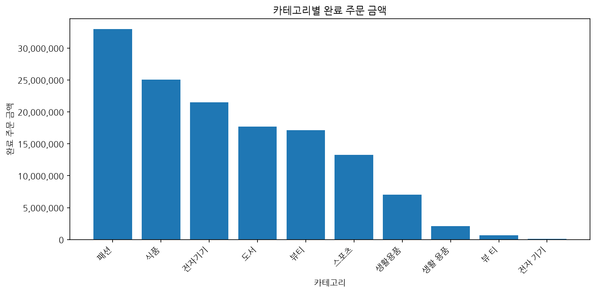
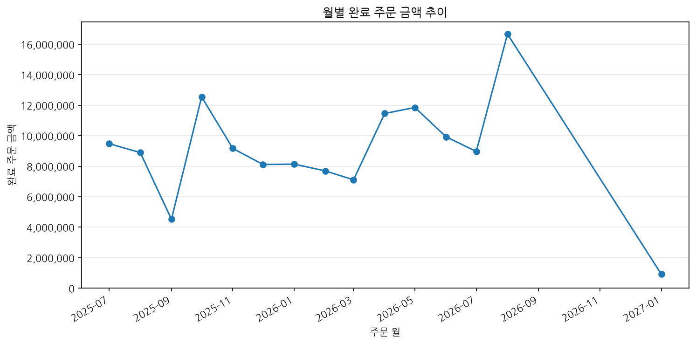
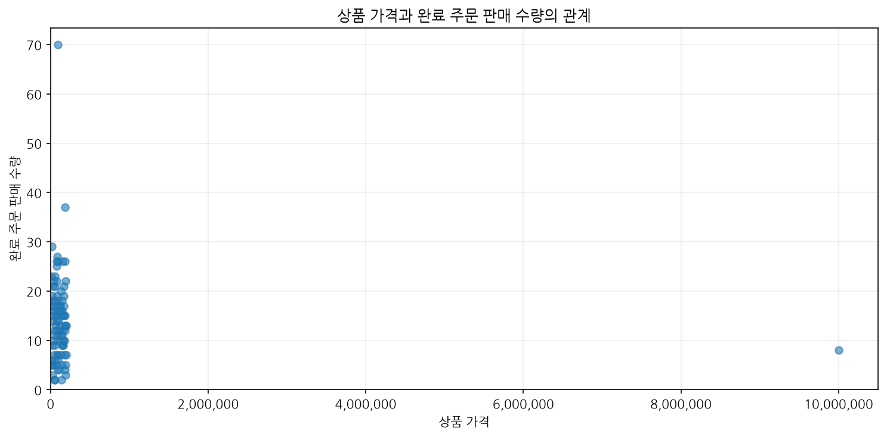

# Chapter 07 답안 양식. 그래프로 데이터의 이야기를 보여주기

> 이 내용을 `chapter07.ipynb`의 Markdown 셀로 작성합니다.

## 제출 정보
- 이름: `이경석`
- GitHub ID: `leeks2026`
- 작성일: `20261018`
- 최종 Notebook URL: `https://github.com/leeks2026/llm-data-analysis-study/blob/main/chapter07/chapter07.ipynb`

## 1. 시각화 질문과 그래프 선택
| 질문 | 선택한 그래프 | 선택 이유 |
| --- | --- | --- |
| 완료 주문 금액이 카테고리별로 어떻게 다른가? | 막대그래프 | 카테고리별 금액 비교에 적합합니다. |
| 월별 완료 주문 금액은 어떻게 변하는가? | 선그래프 | 시간 순서의 추세 확인에 적합합니다. |
| 상품 가격과 완료 판매 수량 사이에 어떤 분포가 있는가? | 산점도 | 두 수치형 변수의 분포와 이상치 확인에 적합합니다. |

## 2. 대표 그래프 1

### 원본 집계값
완료 주문 기준 카테고리별 금액 합계는 137,325,000원입니다.

### 결과 관찰
패션 32,940,000원으로 가장 높고 식품, 전자기기 순입니다.

### 나의 해석과 판단
카테고리별 금액 규모 차이를 확인할 수 있으나 고객 선호나 수익성의 원인으로 단정할 수 없습니다.

### 업무·분석적 의미
후속 판매 수량·평균 단가 분석의 우선순위를 정할 수 있습니다.

### 한계와 추가 확인 사항
판매 수량·상품 수·할인·재고를 추가 확인해야 합니다.

## 3. 대표 그래프 2

### 원본 집계값
완료 주문 기준 카테고리별 금액 합계는 137,325,000원입니다.

### 결과 관찰
패션 32,940,000원으로 가장 높고 식품, 전자기기 순입니다.

### 나의 해석과 판단
카테고리별 금액 규모 차이를 확인할 수 있으나 고객 선호나 수익성의 원인으로 단정할 수 없습니다.

### 업무·분석적 의미
후속 판매 수량·평균 단가 분석의 우선순위를 정할 수 있습니다.

### 한계와 추가 확인 사항
판매 수량·상품 수·할인·재고를 추가 확인해야 합니다.

## 4. 대표 그래프 3

### 원본 집계값
완료 주문 기준 카테고리별 금액 합계는 137,325,000원입니다.

### 결과 관찰
패션 32,940,000원으로 가장 높고 식품, 전자기기 순입니다.

### 나의 해석과 판단
카테고리별 금액 규모 차이를 확인할 수 있으나 고객 선호나 수익성의 원인으로 단정할 수 없습니다.

### 업무·분석적 의미
후속 판매 수량·평균 단가 분석의 우선순위를 정할 수 있습니다.

### 한계와 추가 확인 사항
판매 수량·상품 수·할인·재고를 추가 확인해야 합니다.

## 5. 그래프 정확성 점검
- [x] 그래프 값과 집계표 값 일치
- [x] 축 이름 확인
- [x] 단위 확인
- [x] 범례 확인
- [x] 날짜 정렬 확인
- [x] 과장될 수 있는 축 범위 확인
- [x] 제목이 분석 범위를 정확히 표현

### 내가 발견한 시각화 위험 또는 개선점
상품 가격 9,999,999원의 이상치가 있어 일반 가격대의 분포가 작게 보일 수 있습니다. 월별 그래프에는 날짜가 없는 완료 주문 6행이 포함되지 않았으므로 집계 범위를 함께 표시해야 합니다.

## 6. Chapter 07 최종 판단
### 가장 중요한 그래프 1개와 이유
월별 완료 주문 금액 선그래프를 가장 중요하게 보았습니다. 시간 순서에 따른 금액 변화와 변동 폭을 확인할 수 있기 때문입니다.

### 그래프가 보여 준 사실
유효한 주문일 기준으로 2026년 8월 완료 금액이 16,668,000원으로 가장 높았고, 유효 날짜 월별 합계는 135,422,000원이었습니다.

### 그래프만으로 말할 수 없는 것
프로모션, 계절성, 가격, 재고 또는 고객 행동이 금액 변화의 원인이라고 단정할 수 없습니다. 그래프만으로 고객 충성도나 수익성도 판단할 수 없습니다.

### 다음 분석에서 확인할 질문
월별 주문 수와 평균 주문 금액, 카테고리별 월별 금액을 비교해 특정 월의 금액 차이를 구성하는 요인을 확인하겠습니다.

