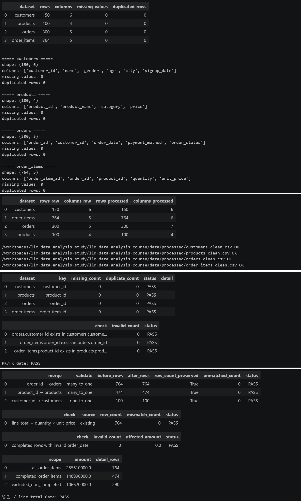
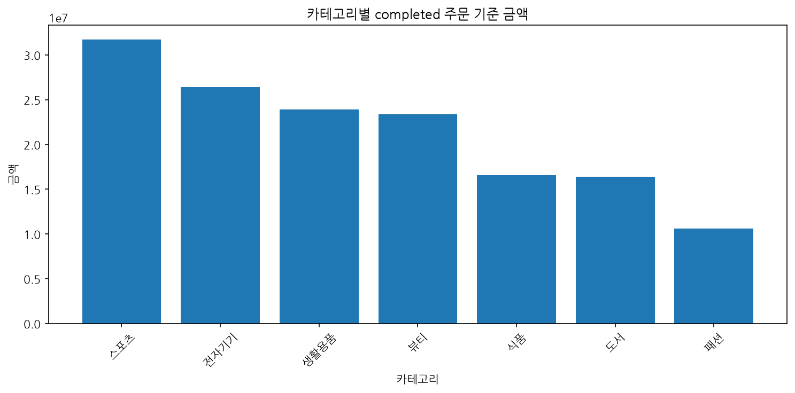
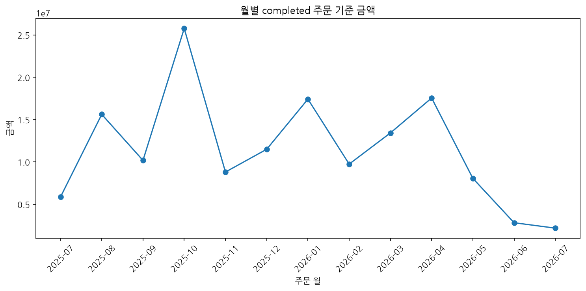
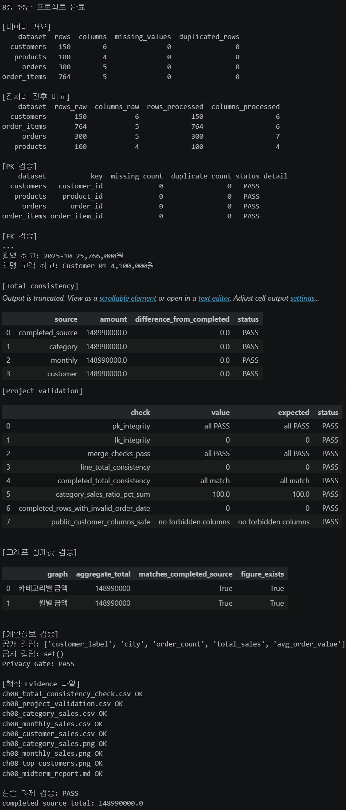

# Chapter 08 답안 양식. 작은 데이터 분석 프로젝트 완성하기

> 이 내용을 `chapter08.ipynb`의 Markdown 셀로 작성합니다.

## 제출 정보
- 이름: `이경석`
- GitHub ID: `leeks2026`
- 작성일: `20261025`
- 최종 Notebook URL: 

## 1. 프로젝트 질문
### 분석 질문
완료 주문을 기준으로 카테고리·월·고객별 구매 금액을 비교하고, 검증을 통과한 결과의 판매 패턴을 확인합니다.

### 분석 범위
금액성 분석은 `order_status == "completed"`인 주문만 사용합니다.

### 사용할 데이터와 지표
customers, products, orders, order_items를 사용하고 `line_total`, 주문 수, 총 구매 금액, 평균 주문 금액을 확인합니다.

### 계산 기준
- `order_status == "completed"` 적용 여부: 적용
- `line_total = quantity × unit_price` 확인 여부: 확인 완료

### 완료 기준
PK/FK, 병합, line_total, 총합, 날짜, 개인정보 검증이 PASS이고 결과 파일과 그래프를 재생성할 수 있어야 합니다.

## 2. 입력 데이터와 전처리 검증
- 사용 원본 파일: `data/raw`의 customers.csv, products.csv, orders.csv, order_items.csv
- shape: customers 150행·6열, products 100행·4열, orders 300행·5열, order_items 764행·5열
- 핵심 결측/중복 결과: 결측 0건, 중복 0건
- 전처리 전후 변화: 네 데이터셋 모두 행 수가 유지되었습니다.

### 나의 해석과 판단
검증 대상 데이터의 기본 품질은 양호합니다.

### 한계와 추가 확인 사항
검증 결과만으로 판매 원인이나 고객 행동의 원인을 설명할 수 없습니다.

## 3. PK/FK·병합 검증
### PK 결과
- 결측: 0건
- 중복: 0건
- PASS/FAIL: PASS

### FK 결과
- 미매칭: 0건
- PASS/FAIL: PASS

### 병합 결과
- validate 관계: many_to_one, many_to_one, one_to_one 모두 PASS
- 병합 전 행 수: 764, 474, 100
- 병합 후 행 수: 764, 474, 100
- 미매칭: 0건
- PASS/FAIL: PASS

### 나의 해석과 판단
PK/FK와 병합 검증이 모두 통과하여 집계에 사용할 연결 관계를 확인했습니다.

## 4. 핵심 EDA 결과
### 결과 1
- 수치/표: 스포츠 31,743,000원, 전자기기 26,400,000원, 생활용품 23,915,000원
- 결과 관찰: 스포츠 금액이 가장 높습니다.
- 나의 해석과 판단: 카테고리별 완료 금액 규모를 확인했습니다.
- 업무·분석적 의미: 후속 수량·단가 분석의 우선순위를 정할 수 있습니다.
- 한계: 금액만으로 판매 수량이나 단가의 원인을 구분할 수 없습니다.

### 결과 2
- 수치/표: 2025년 10월 완료 주문 금액 25,766,000원
- 결과 관찰: 해당 월의 금액이 기간 중 가장 높습니다.
- 나의 해석과 판단: 월별 금액 변동을 확인했습니다.
- 업무·분석적 의미: 월별 주문 수와 평균 주문 금액을 추가 분석할 기준이 됩니다.
- 한계: 프로모션이나 계절성을 원인으로 단정할 수 없습니다.

### 결과 3
- 수치/표: 고객별 완료 주문 금액은 익명 라벨로 집계
- 결과 관찰: 상위 구매 금액 고객군을 확인할 수 있습니다.
- 나의 해석과 판단: 금액이 높다고 반복 구매나 충성도를 의미하지는 않습니다.
- 업무·분석적 의미: 구매 빈도와 최근 구매일을 함께 분석할 필요가 있습니다.
- 한계: 고객 행동의 원인과 충성도를 금액만으로 판단할 수 없습니다.

## 5. Total consistency와 날짜 검증
- completed source total: 148,990,000원
- category total: 148,990,000원
- monthly total: 148,990,000원
- customer total: 148,990,000원
- 총합 일치 여부: 일치
- completed 주문 날짜 오류 건수: 0건
- 날짜 오류 영향 금액: 0원

### 불일치가 있었다면 원인
불일치가 없으므로 해당하지 않습니다.

## 6. 대표 시각화

### 그래프 선택 이유
카테고리별 금액은 막대그래프, 월별 금액은 선그래프를 사용해 규모와 시간 흐름을 비교했습니다.

### 그래프와 원본 집계값 일치 여부
카테고리·월·고객 집계 합계가 각각 148,990,000원으로 일치합니다.

### 그래프에서 직접 관찰한 사실
스포츠 카테고리 금액이 31,743,000원으로 가장 높고, 2025년 10월 월별 금액이 25,766,000원으로 가장 높습니다.

### 그래프만으로 말할 수 없는 것
프로모션·계절성·가격·재고가 금액 차이의 원인이라고 단정할 수 없습니다.

## 7. 개인정보 검증
- 공개 고객 CSV 컬럼: customer_label, city, order_count, total_sales, avg_order_value
- 원본 `customer_id` 포함 여부: 미포함
- 이름/이메일/전화번호/주소 포함 여부: 미포함
- 익명 라벨 방식: Customer 01과 같은 익명 라벨
- PASS/FAIL: PASS

### 나의 판단
공개 결과는 익명 라벨과 집계 지표만 사용하여 원본 고객 식별정보를 노출하지 않습니다.

## 8. 최종 Validation
`reports/ch08_project_validation.csv`의 결과를 요약합니다.

| 검증 항목 | 결과 | 내가 확인한 근거 |
| --- | --- | --- |
| pk_integrity | PASS | PK 결측·중복 0건 |
| fk_integrity | PASS | FK 미매칭 0건 |
| merge_checks_pass | PASS | 병합 행 수 보존·미매칭 0건 |
| line_total_consistency | PASS | 불일치 0건 |
| completed_total_consistency | PASS | 네 합계 모두 148,990,000원 |
| category_sales_ratio_pct_sum | PASS | 비율 합계 100.0 |
| completed_rows_with_invalid_order_date | PASS | 오류 0건 |
| public_customer_columns_safe | PASS | 금지 컬럼 없음 |

### FAIL이 있었다면 수정 내용
FAIL 항목이 없으므로 수정 사항은 없습니다.

## 9. LLM 활용 기록
- 사용 여부: 사용
- 사용 목적: 해석의 과대 표현과 추가 검증 항목 검토
- Safe Context: 집계 수치와 검증 결과만 제공하고 고객 식별정보는 제외
- Prompt 요약: 완료 주문 금액 분석의 해석 범위와 추가 확인 지표 검토
- 제안 요약: 수량·평균 단가·구매 빈도·최근 구매일 확인
- 반영/수정/보류: 제안을 반영하고 원인은 단정하지 않음
- 사람이 검증한 근거: 집계 CSV와 Validation CSV를 직접 대조

## 10. 프로젝트 재현 확인
- `python scripts/run_midterm_project.py` 실행 여부: 실행
- 재실행 결과: completed total 148,990,000원, 검증 항목 PASS
- Notebook과 핵심 수치 일치 여부: 일치
- 생성된 핵심 Evidence 파일 확인 여부: 확인

### 나의 해석과 판단
원본부터 같은 계산을 반복해도 같은 결과를 얻는지 확인할 수 있어, 이전 메모리 상태나 수작업에 의존하지 않고 결과를 검증할 수 있습니다.

## 11. 최종 프로젝트 요약
### 핵심 인사이트 3개
1. 완료 주문 총액은 148,990,000원이며 모든 금액 집계와 일치합니다.
2. 스포츠 카테고리와 2025년 10월의 완료 금액이 각각 가장 높습니다.
3. PK/FK·병합·line_total·날짜·개인정보 검증이 모두 PASS입니다.

### 가장 중요한 업무·분석적 의미
동일한 completed 범위에서 여러 집계 결과를 교차 검증해 분석 결과의 신뢰성을 확보했습니다.

### 현재 분석의 한계
금액만으로 판매 원인, 고객 충성도, 수익성을 판단할 수 없습니다.

### 다음 분석 제안
1. 카테고리별 판매 수량과 평균 단가를 비교합니다.
2. 월별 주문 수와 평균 주문 금액을 함께 분석합니다.
3. 고객별 구매 빈도와 최근 구매일을 확인합니다.

## 최종 체크
- [x] 질문과 지표가 연결됩니다.
- [x] 원본 데이터에서 다시 시작했습니다.
- [x] PK/FK·병합 검증 근거가 있습니다.
- [x] `line_total` 계산 관계를 확인했습니다.
- [x] 금액성 분석은 completed 범위를 사용했습니다.
- [x] category/month/customer 총합이 source total과 일치합니다.
- [x] 날짜 오류를 확인했습니다.
- [x] 공개 고객 결과에서 원본 ID와 직접 식별정보를 제거했습니다.
- [x] 대표 그래프와 원본 집계값을 비교했습니다.
- [x] 원인 과대 해석이 없습니다.
- [x] 최종 Validation이 모두 PASS입니다.
- [x] 전체 프로젝트를 재실행했습니다.
- [x] 한계와 다음 분석을 작성했습니다.
- [x] 최종 Notebook URL을 제출합니다.