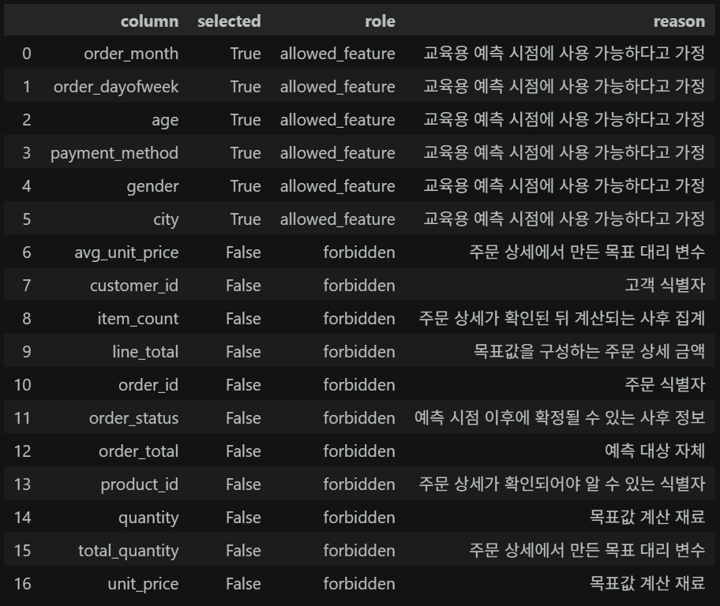
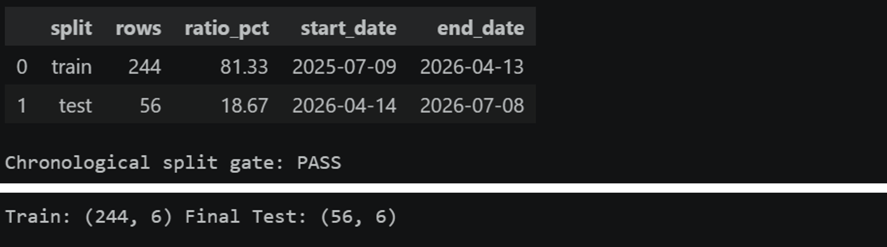
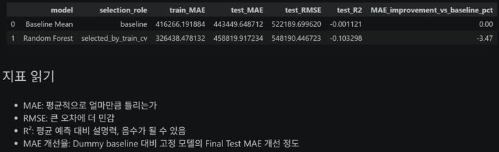

# Chapter 09 답안 양식. 회귀 분석으로 숫자 예측하기

> 이 내용을 `chapter09.ipynb`의 Markdown 셀로 작성합니다.

## 제출 정보
- 이름: `이경석`
- GitHub ID: `leeks2026`
- 작성일: `20261107`
- 최종 Notebook URL:

## 1. 예측 문제 정의
- Target: 주문 1건의 주문 상세 금액 합계 `order_total`
- 예측 단위: 주문 1건
- 예측 시점: 주문 메타데이터와 고객의 비식별 특성을 확인할 수 있지만 주문 상세가 생성되기 전
- 예측 시점에 알 수 있는 정보: 주문 월·요일, 결제수단, 성별, 나이, 도시
- 예측 시점에 알 수 없는 정보: 주문 상세 수량·단가·금액, `order_id`, `customer_id`, `product_id`, 주문 상태

### 나의 해석과 판단
왜 이 예측 시점을 선택했는지 작성하세요.

주문 금액을 계산한 뒤 그 금액을 feature로 사용하면 Target 누수가 발생하므로, 주문 상세가 확정되기 전 알 수 있는 정보만 사용하도록 시점을 정했습니다.

---

## 2. Feature Leakage Audit

| feature | 예측 시점 사용 가능 | Target 계산 재료 | 사후 정보/ID | 최종 사용 | 판단 이유 |
| --- | --- | --- | --- | --- | --- |
| order_month, order_dayofweek, age, payment_method, gender, city | 예 | 아니오 | 아니오 | 예 | 예측 시점에 알 수 있는 주문·고객 특성 |
| order_total, line_total, quantity, unit_price, total_quantity, item_count, avg_unit_price, order_id, customer_id, product_id, order_status | 아니오 | 일부 | 일부 | 아니오 | Target 계산 재료, 사후 정보 또는 식별자 |

- 금지 feature overlap 개수: 0
- 가장 위험하다고 판단한 feature: `line_total`과 `order_total`
- 이유: 주문 금액 자체 또는 그 계산 재료를 입력하면 예측이 아니라 Target을 미리 사용하게 됩니다.



---

## 3. Target 생성과 관계 검증

### 계산 기준

```text
line_total = quantity × unit_price
order_total = 주문별 line_total의 합계
```

- line_total 검증 결과: 전처리된 주문 상세를 사용해 주문별 금액을 구성했습니다.
- orders ↔ target 관계 검증 결과: 주문 300건과 Target 300건이 주문 단위로 1:1 대응합니다.
- orders → customers 관계 검증 결과: 주문과 고객 병합 관계를 검증한 뒤 사용했습니다.

### 나의 해석과 판단
관계 검증 없이 병합만 수행하면 어떤 문제가 생길 수 있는지 작성하세요.

키 중복이나 미매칭을 확인하지 않으면 행이 중복되어 Target이 부풀거나 고객 정보가 누락된 채 모델에 들어갈 수 있습니다.

---

## 4. Train / Final Test 분할

- Train 시작일: 2025-07-09
- Train 종료일: 2026-04-13
- Train 행 수: 244
- Final Test 시작일: 2026-04-14
- Final Test 종료일: 2026-07-08
- Final Test 행 수: 56
- 같은 달력 날짜 중복 여부: 없음

### 분할 판단
왜 이번 문제에서 시간 순서 분할을 사용하는지 작성하세요.

실제 예측은 과거 정보로 미래 주문을 예측하는 방식이므로 시간 순서를 지켜야 합니다. 무작위 분할을 하면 미래 정보가 학습에 섞여 성능이 과대평가될 수 있습니다.



---

## 5. Train TimeSeriesSplit 후보 비교

| 모델 | CV MAE 평균 | CV MAE 표준편차 | CV R² 평균 | 비고 |
| --- | ---: | ---: | ---: | --- |
| Baseline Mean | 423,004.81 | 44,153.04 | -0.0228 | 비교 기준 |
| Linear Regression | 461,386.29 | 77,792.80 | -0.3105 | 후보 |
| Random Forest | 437,352.80 | 26,318.79 | -0.1097 | 후보 |

### Train CV로 선택한 비베이스라인 모델
- Selected Model: Random Forest
- 선택 기준: Baseline을 제외한 후보 중 Train TimeSeriesSplit의 CV MAE 평균이 더 낮은 모델
- Final Test 결과를 보기 전에 선택했는가: 예

### 나의 해석과 판단
CV 평균뿐 아니라 표준편차도 함께 봐야 하는 이유를 작성하세요.

평균 MAE가 낮아도 표준편차가 크면 분할에 따라 성능이 불안정할 수 있습니다. 따라서 평균과 변동성을 함께 확인해야 모델 선택의 안정성을 판단할 수 있습니다.

---

## 6. Final Test: Baseline vs Frozen Model

| 모델 | selection role | Train MAE | Test MAE | Test RMSE | Test R² | Baseline 대비 MAE 개선율 |
| --- | --- | ---: | ---: | ---: | ---: | ---: |
| Baseline Mean | baseline | 416,266.19 | 443,449.65 | 522,189.70 | -0.0011 | 0.00% |
| Frozen Selected Model (Random Forest) | selected_by_train_cv | 326,438.48 | 458,819.92 | 548,190.45 | -0.1033 | -3.47% |



### 결과 관찰

Random Forest는 Train CV에서 선택되었지만 Final Test MAE가 458,819.92원으로 Baseline의 443,449.65원보다 높았습니다. 따라서 Baseline 대비 MAE 개선율은 -3.47%입니다.

### 나의 해석과 판단
- Frozen Model이 baseline보다 실제로 개선되었는가?
- MAE와 RMSE 차이에서 무엇을 볼 수 있는가?
- R²는 어떻게 해석할 수 있는가?

Random Forest는 Final Test에서 Baseline보다 개선되지 않았습니다. RMSE가 MAE보다 크므로 큰 오차의 영향을 확인해야 하며, Random Forest의 R²는 -0.1033으로 평균값을 사용하는 기준보다 설명력이 낮습니다. Baseline의 R²도 -0.0011로 실질적인 설명력이 거의 없습니다.

### 업무·분석적 의미
현재 오차 수준이 실제 사용에서 어떤 의미인지 작성하세요.

평균적인 주문 금액 예측 오차가 약 44만~46만 원 수준이고 Baseline보다 개선되지 않았으므로, 현재 상태에서 운영 의사결정에 직접 사용하기에는 위험합니다.

---

## 7. 대표 오차 사례

### 사례 1
- 실제값: 1,877,000원
- 예측값: 약 605,529원
- residual: 약 1,271,471원
- absolute error: 약 1,271,471원
- 관찰: 실제 주문 금액을 크게 낮게 예측했습니다.
- 가능한 이유 후보: 현재 feature에 주문 상세 수량·단가가 없어서 고액 주문의 변동을 설명하지 못했을 가능성이 있습니다.
- 추가 확인: 주문 상세 수량·단가 분포와 예측 시점에 사용할 수 있는 추가 사전 정보를 확인합니다.

### 사례 2
- 실제값: 10,000원
- 예측값: 약 897,415원
- residual: 약 -887,415원
- absolute error: 약 887,415원
- 관찰: 실제 주문 금액을 크게 높게 예측했습니다.
- 가능한 이유 후보: 소액 주문을 구분할 수 있는 feature가 제한적이었을 가능성이 있습니다.
- 추가 확인: 소액 주문의 결제수단·도시·요일·상품 구성과 결측·이상치 여부를 확인합니다.

> 원인을 데이터가 직접 보여 주지 않는다면 사실처럼 단정하지 않습니다.

---

## 8. Validation Evidence

`reports/ch09_regression_validation.csv` 기준으로 작성하세요.

| check | value | status |
| --- | --- | --- |
| forbidden_feature_overlap | 0 | PASS |
| strict_train_before_test | True | PASS |
| selected_model_exists_in_train_cv | True | PASS |
| final_test_contains_baseline | True | PASS |
| final_test_contains_frozen_selected_model | True | PASS |
| test_rows_for_r2 | 56 | PASS |

### FAIL 항목
- 없음 / 있음: 없음
- 있다면 원인과 수정 내용: 해당 없음

---

## 9. Evidence와 공개 범위

### 생성된 Evidence
- [x] `ch09_regression_split_summary.csv`
- [x] `ch09_regression_feature_audit.csv`
- [x] `ch09_regression_cv_summary.csv`
- [x] `ch09_regression_model_comparison.csv`
- [x] `ch09_regression_validation.csv`
- [x] `ch09_regression_checklist.csv`

### Internal 파일
- [x] `ch09_regression_model_data_internal.csv`
- [x] `ch09_regression_predictions_internal.csv`

### 공개 결과
- [x] `ch09_regression_report.md`
- [x] `ch09_actual_vs_predicted.png`
- [x] `ch09_residual_histogram.png`

### 공개 범위 판단
왜 `order_id`가 포함된 예측 결과를 Internal로 구분해야 하는지 작성하세요.

`order_id`는 개별 주문을 다시 식별할 수 있는 내부 식별자이므로 공개 결과에 포함하면 안 됩니다. 오차 진단에는 필요하지만 공개 보고서에서는 제거하거나 집계 수준으로 제공해야 합니다.

---

## 10. 최종 사용 판단

- [ ] 현재 수준에서 참고용 사용 가능
- [ ] 추가 검증 후 사용 가능
- [x] 현재 데이터로는 사용 보류

### 판단 근거
1. Random Forest의 Final Test MAE가 Baseline보다 3.47% 나빴습니다.
2. Random Forest Test R²가 -0.1033이고 Baseline도 -0.0011로 설명력이 충분하지 않습니다.
3. 현재 feature만으로는 주문 상세 금액의 변동을 충분히 설명하기 어렵습니다.

### 업무적 위험

예측 금액을 실제 의사결정에 사용하면 고액·소액 주문을 크게 잘못 추정해 재고·마케팅·매출 계획에 잘못된 판단을 유발할 수 있습니다.

### 현재 데이터의 한계

주문 상세 수량·단가·상품 정보와 프로모션 등 주문 금액에 직접 영향을 주는 정보가 예측 feature에서 제외되어 있습니다. 또한 데이터 규모가 300건으로 제한적입니다.

### 다음 개선 우선순위
1. 예측 시점에 사용할 수 있는 상품·장바구니·프로모션 정보를 추가하고 누수 여부를 재검증합니다.
2. 더 긴 기간의 주문과 다양한 주문 특성을 확보해 시간 검증을 반복합니다.
3. 고액·소액 주문의 오차 원인을 별도로 분석하고 Baseline 대비 개선을 재확인합니다.

---

## 11. 전체 재실행 확인

실행 명령:

```powershell
python scripts/run_regression_analysis.py
```

- 실행 성공 여부: 성공 (`PYTHONPATH="$PWD" python scripts/run_regression_analysis.py`)
- Train CV Selected Model: Random Forest
- Final Validation 전체 PASS 여부: 전체 PASS
- Notebook 결과와 스크립트 결과의 일관성: 일치

---

## 최종 체크

- [x] Target과 예측 시점을 정의했습니다.
- [x] Leakage Audit을 수행했습니다.
- [x] Target 계산과 관계 검증을 확인했습니다.
- [x] Train과 Final Test가 시간 순서로 엄격히 분리되었습니다.
- [x] 전처리가 Pipeline 내부에서 학습됩니다.
- [x] Train TimeSeriesSplit으로 후보를 비교했습니다.
- [x] Final Test 전에 Selected Model을 고정했습니다.
- [x] Final Test에서는 Baseline과 Frozen Model만 비교했습니다.
- [x] MAE, RMSE, R²를 함께 해석했습니다.
- [x] 대표 오차 사례를 관찰과 가설로 구분했습니다.
- [x] Validation Evidence가 모두 PASS입니다.
- [x] Internal 결과와 공개 결과를 구분했습니다.
- [x] 낮은 성능도 숨기지 않았습니다.
- [x] 전체 스크립트를 재실행했습니다.
- [x] 최종 Notebook URL을 제출합니다.
