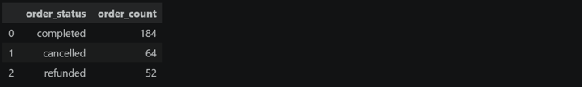
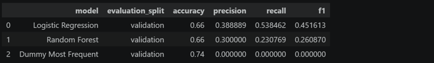
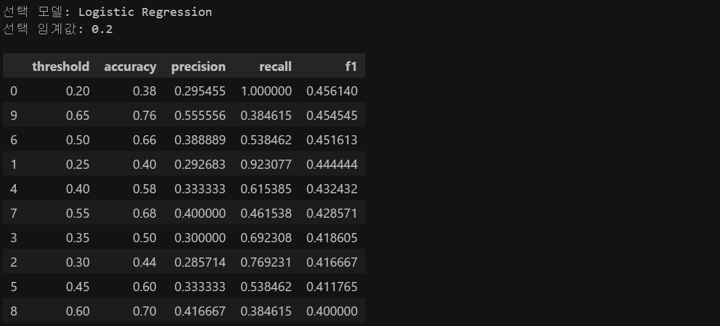
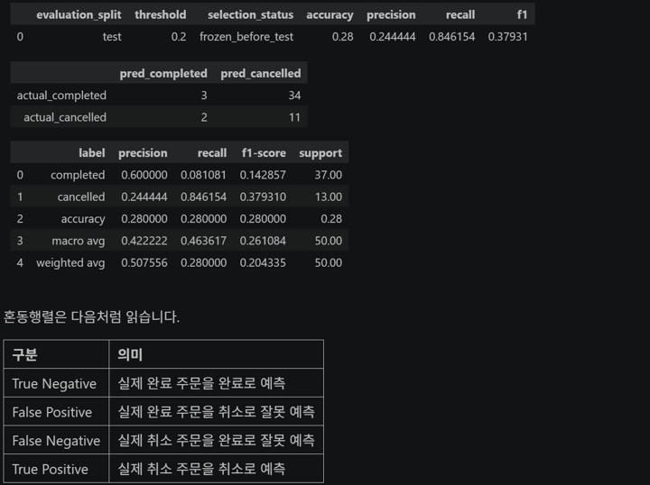

# Chapter 10 답안 양식. 분류 분석으로 주문 취소 여부 예측하기

> 이 내용을 `chapter10.ipynb`의 Markdown 셀로 작성합니다. 실제 실행 결과를 근거로 작성하고, 예측 패턴을 원인처럼 단정하지 않습니다.

## 제출 정보
- 이름: `이경석`
- GitHub ID: `leeks2026`
- 작성일: `20261111`
- 최종 Notebook URL: `https://github.com/leeks2026/llm-data-analysis-study/blob/main/chapter10/chapter10.ipynb`

## 1. 분류 문제 정의
- 타깃:
  - 답: 주문 한 건의 취소 여부를 나타내는 is_cancelled입니다.
- 0의 의미:
  - 답: 완료 주문(completed)입니다.
- 1의 의미:
  - 답: 취소 주문(cancelled)입니다.
- 제외한 상태:
  - 답: refunded 52건과 기타 상태입니다. 이번 실행 데이터에서 타깃 이외 상태는 refunded 52건입니다.
- 예측 단위:
  - 답: 주문 한 건입니다.
- 예측 시점:
  - 답: 주문이 접수되고 주문 특징을 확인할 수 있지만 완료·취소 결과는 확정되지 않은 시점이라고 가정합니다.
- 예측 시점에 사용할 수 있는 정보:
  - 답: 나이, 성별, 도시, 결제수단, 주문 월·요일, 주문 상세에서 계산한 상품 수·수량·주문 금액, 가입 경과 일수입니다. 실제 운영에서 이 시점에 확보되는지는 별도 확인이 필요합니다.
- 예측 이후에만 알 수 있어 제외한 정보:
  - 답: order_status와 is_cancelled, 주문·고객·상품 식별자, 취소 사유와 취소 시각 등입니다.

### 나의 해석과 판단
완료와 취소를 비교하는 이진 분류이므로 completed=0, cancelled=1로 정하고 환불은 다른 상태이므로 제외했습니다. 예측 시점에 실제로 사용할 수 있는 정보만 입력한다는 가정을 두어 결과 상태와 식별자 같은 누수 가능 변수를 배제했습니다. 주문 상세 특징을 이 시점에 알 수 있다는 점은 교육용 가정이며 운영 전 확인이 필요합니다.

---

## 2. Feature Contract와 Leakage Audit

### 사용한 숫자형 Feature
age, item_count, total_quantity, order_amount, order_month, order_dayofweek, days_since_signup입니다. 날짜 역전 45건은 days_since_signup만 결측 처리했으며 숫자형 Pipeline의 중앙값 대체 대상입니다.

### 사용한 범주형 Feature
gender, city, payment_method입니다. 결측 대체와 OneHotEncoder는 Pipeline 안에서 학습 데이터 기준으로 처리합니다.

### 금지 Feature

```text
order_status
is_cancelled
order_id
customer_id
product_id
취소 이후 정보
```

### 나의 해석과 판단
데이터에 기록되어 있어도 예측 시점 이후에 생성되는 값이면 실제 예측에서는 알 수 없고, 학습에 넣으면 미래 정보를 미리 사용하게 됩니다. 식별자는 주문 자체의 패턴을 외우게 할 수 있어 일반화에 도움이 되지 않으므로 feature에서 제외했습니다.

---

## 3. 주문 단위 특징과 병합 검증

### 계산 관계 확인

```text
line_total = quantity × unit_price
```

- 계산 불일치 건수:
  - 답: 0건입니다.
- 주문 특징 `order_id` 중복 건수:
  - 답: 0건입니다. 주문 단위 특징 테이블은 order_id당 한 행입니다.

### 병합 검증

| 병합 | 관계 | 병합 전 행 수 | 병합 후 행 수 | 미매칭 | 판정 |
| --- | --- | ---: | ---: | ---: | --- |
| 주문 ↔ 주문 특징 | one_to_one | 248 | 248 | 0 | PASS |
| 주문 ↔ 고객 | many_to_one | 248 | 248 | 0 | PASS |

### 결과 관찰

주문 상세 764행의 line_total 계산 불일치는 0건입니다. 분류 대상 248건을 주문 특징 및 고객과 병합한 뒤에도 각각 248행이 유지됐고 미매칭은 모두 0건입니다.

### 나의 해석과 판단
미매칭을 원인 확인 없이 0으로 채우면 안 되는 이유를 작성하세요.

미매칭은 연결 키 오류나 누락일 수 있어 0으로 채우면 실제로 확인되지 않은 주문 특징을 정상적인 0으로 오해할 수 있습니다. 이번 실행은 두 병합 모두 미매칭 0건으로 확인했습니다.

---

## 4. 클래스 비율

| 클래스 | 의미 | 개수 | 비율 |
| ---: | --- | ---: | ---: |
| 0 | completed | 184 | 74.19% |
| 1 | cancelled | 64 | 25.81% |



### 결과 관찰
완료 주문은 184건(74.19%), 취소 주문은 64건(25.81%)으로 완료 클래스가 더 많습니다.

### 나의 해석과 판단
다수 클래스인 완료만 예측해도 정확도가 높게 나올 수 있습니다. Dummy 모델은 accuracy 0.74였지만 취소 recall과 F1은 0이었습니다. 따라서 정확도만으로 취소 탐지 성능을 판단하지 않았습니다.

---

## 5. Dummy Baseline과 Validation 모델 비교

| 모델 | Accuracy | Precision | Recall | F1 |
| --- | ---: | ---: | ---: | ---: |
| Dummy Most Frequent | 0.7400 | 0.0000 | 0.0000 | 0.0000 |
| Logistic Regression | 0.6600 | 0.3889 | 0.5385 | 0.4516 |
| Random Forest | 0.6600 | 0.3000 | 0.2308 | 0.2609 |



- Validation에서 선택한 모델:
  - 답: Logistic Regression입니다.

### 결과 관찰
Logistic Regression은 Dummy보다 accuracy가 낮았지만 취소 recall은 0에서 0.5385, F1은 0에서 0.4516으로 높았습니다. Random Forest의 F1은 0.2609였습니다.

### 나의 해석과 판단
취소 탐지 recall과 F1에서 Logistic Regression이 Dummy보다 나았습니다. 다만 accuracy는 Dummy 0.74, Logistic Regression 0.66이므로 개선은 취소 탐지 관점에 한정됩니다.

### 한계와 추가 확인 사항
Validation은 50건(취소 13건)뿐이라 지표 변동이 클 수 있습니다. FP/FN 비용을 확인하고 더 긴 기간 데이터로 재평가해야 합니다.

---

## 6. Train / Validation / Test 역할

| Split | 역할 | 클래스 0 건수 | 클래스 1 건수 |
| --- | --- | ---: | ---: |
| Train | 모델 학습 | 110 | 38 |
| Validation | 모델·Threshold 선택 | 37 | 13 |
| Test | 선택 이후 최종 평가 | 37 | 13 |

### 나의 해석과 판단
Test를 반복해 모델이나 임계값을 고르면 Test 정보에 맞춘 선택이 되어 최종 성능을 낙관적으로 평가할 수 있습니다. 이번 실행은 Validation에서 선택한 뒤 Test를 평가했습니다.

### 교육용 random split의 한계
무작위 분할은 과거 주문으로 미래 주문을 예측하는 시간 구조를 보장하지 않습니다. 운영 전에는 날짜 기준의 과거 학습·미래 평가(out-of-time) 검증을 추가해야 합니다.

---

## 7. Validation 성능과 우선 지표

- Accuracy:
  - 답: 0.6600
- Precision:
  - 답: 0.3889
- Recall:
  - 답: 0.5385
- F1:
  - 답: 0.4516

### 내가 가장 중요하게 본 지표
F1을 우선 지표로 보고 recall도 함께 확인했습니다.

### 그 이유
F1은 precision과 recall을 함께 반영합니다. 실제 FP/FN 비용 정보가 없어 업무상 최적 지표를 확정할 수는 없습니다.

> 실제 FP/FN 비용 정보가 없다면 가정임을 명시하세요.

---

## 8. Threshold 비교

| Threshold | Precision | Recall | F1 | 예상 특징 |
| ---: | ---: | ---: | ---: | --- |
| 0.20 | 0.2955 | 1.0000 | 0.4561 | 취소를 모두 찾았지만 FP가 늘 수 있음 |
| 0.50 | 0.3889 | 0.5385 | 0.4516 | 정밀도와 재현율의 절충 |
| 0.65 | 0.5556 | 0.3846 | 0.4545 | 정밀도는 높지만 취소를 더 놓칠 수 있음 |



### 내가 선택한 Threshold
0.20

### 선택 이유
Validation에서 F1이 가장 높았고(0.4561), 취소 recall은 1.0000이었습니다. threshold 0.65의 F1 0.4545와 차이가 작아 업무상 최선이라고 단정할 수는 없습니다.

### 나의 해석과 판단
Test를 선택에 사용하면 최종 평가 자료에 과적합됩니다. 모델과 threshold는 Validation에서 고정했습니다.

---

## 9. FP/FN 해석

- FP 의미:
  - 답: 실제 완료 주문을 취소 위험으로 잘못 예측한 경우이며 Test에서 34건입니다.
- FN 의미:
  - 답: 실제 취소 주문을 완료로 잘못 예측한 경우이며 Test에서 2건입니다.
- 현재 목적에서 더 부담스러울 수 있는 오류:
  - 답: 취소 탐지 목적상 FN은 취소를 놓치는 오류지만 Test FP가 34건으로 많습니다. 실제 비용 정보가 없어 어느 쪽이 더 부담스러운지 확정할 수 없습니다.
- 그 판단에 추가로 필요한 업무 정보:
  - 답: 오탐으로 생기는 확인·보류·고객 응대 비용과 취소를 놓쳤을 때의 재고·배송·고객지원 비용이 필요합니다.



### 업무·분석적 의미
threshold 0.20은 취소 recall을 높였지만 완료 주문 37건 중 34건을 취소로 잘못 표시했습니다. 자동 조치로 연결하기에는 오탐 위험이 큽니다.

### 한계와 추가 확인 사항
Test가 50건이고 취소는 13건이라 다른 기간에도 결과가 유지되는지 알 수 없습니다. FP/FN 비용, 예측 시점의 feature 가용성, 시간에 따른 성능 변화를 추가 확인해야 합니다.

---

## 10. Final Test

- 고정한 모델:
  - 답: Logistic Regression
- 고정한 Threshold:
  - 답: 0.20
- Accuracy:
  - 답: 0.2800
- Precision:
  - 답: 0.2444
- Recall:
  - 답: 0.8462
- F1:
  - 답: 0.3793
- Validation 대비 변화:
  - 답: threshold 0.20 기준으로 accuracy 0.38→0.28, precision 0.2955→0.2444, recall 1.0000→0.8462, F1 0.4561→0.3793으로 모두 낮아졌습니다.

### 결과 관찰
Test 혼동행렬은 TN 3, FP 34, FN 2, TP 11입니다. 취소 recall은 높지만 완료 주문 오탐이 많고, Test F1 0.3793은 Validation threshold 기준 F1 0.4561보다 낮습니다.

### 나의 해석과 판단
현재 Test 결과만으로 안정적인 일반화를 확인하기 어렵습니다. Test accuracy 0.28, precision 0.2444이고 FP가 34건이라 운영 적용 근거가 부족합니다. Test를 보고 모델이나 threshold를 다시 고르지는 않았습니다.

### 선택 보호 확인
- [x] Test 결과를 보기 전에 모델을 고정했습니다.
- [x] Test 결과를 보기 전에 Threshold를 고정했습니다.
- [x] Test 결과를 본 뒤 같은 Test를 이용해 선택을 바꾸지 않았습니다.

---

## 11. Internal / Public 결과 구분

### 공개 Prediction 컬럼

```text
record_id
actual_is_cancelled
predicted_is_cancelled
cancel_probability
model
threshold
```

### 공개 결과에 없어야 할 컬럼

```text
source_index
order_id
customer_id
product_id
```

### 결과 관찰
공개 Prediction은 record_id, actual_is_cancelled, predicted_is_cancelled, cancel_probability, model, threshold만 사용합니다. 내부 진단용 표에는 source_index가 포함될 수 있으며 공개 결과 파일은 분리 저장합니다.

### 나의 해석과 판단
내부 연결 키는 오류 추적에 유용할 수 있지만 공개에는 불필요한 식별·연결 단서가 될 수 있습니다.

---

## 12. Validation Evidence

다음 Evidence 중 확인한 항목에 체크합니다.

- [x] `ch10_target_distribution.csv`
- [x] `ch10_feature_audit.csv`
- [x] `ch10_merge_checks.csv`
- [x] `ch10_data_quality_checks.csv`
- [x] `ch10_split_summary.csv`
- [x] `ch10_validation_model_comparison.csv`
- [x] `ch10_validation_threshold_metrics.csv`
- [x] `ch10_test_metrics.csv`
- [x] `ch10_confusion_matrix.csv`
- [x] `ch10_classification_validation.csv`

### 자동 Validation 결과
전체 분류 파이프라인이 오류 없이 완료됐고 산출물 경로가 모두 OK였습니다. check별 상태는 생성된 ch10_classification_validation.csv에서 확인합니다.

### 자동 PASS가 의미하지 않는 것
운영 적합성, 공정성, 시간에 따른 성능 변화 및 실제 FP/FN 비용은 자동 검증만으로 보장되지 않습니다.

---

## 13. 최종 사용 판단

- [ ] 참고용 사용 가능
- [ ] 추가 검증 후 사용 가능
- [x] 현재 사용 보류

### 판단 근거
1. Test accuracy 0.28, precision 0.2444, F1 0.3793으로 성능이 낮습니다.
2. 혼동행렬에서 FP가 34건으로 많습니다.
3. Test 50건만으로 다른 기간의 안정성과 실제 업무 비용을 판단할 수 없습니다.

### 현재 모델의 가장 큰 위험
완료 주문을 취소 위험으로 잘못 예측하는 FP가 많아 자동 조치 시 정상 주문에 불필요한 확인이나 제한이 생길 수 있습니다.

### 다음 개선 우선순위
1. 예측 시점의 feature 가용성과 합성 데이터 생성 규칙을 확인합니다.
2. 더 긴 기간의 데이터를 확보해 시간순 검증과 out-of-time 테스트를 합니다.
3. 실제 FP/FN 비용을 확인해 Validation 목표 지표와 threshold를 정합니다.

### 예측과 인과 구분
취소 recall은 높지만 정상 완료 주문 오탐도 많다는 예측 패턴을 보였습니다. 이 결과만으로 고객 특성이나 결제수단이 취소의 원인이라고 주장할 수 없습니다.

---

## 최종 체크

- [x] `completed=0`, `cancelled=1` 타깃 범위를 정의했습니다.
- [x] `refunded`와 기타 상태를 제외했습니다.
- [x] 예측 시점과 Feature Contract를 정의했습니다.
- [x] target, ID, 사후 정보를 feature에서 제외했습니다.
- [x] `line_total = quantity × unit_price`를 검증했습니다.
- [x] 주문 단위 특징과 병합 관계를 검증했습니다.
- [x] 클래스 비율을 확인했습니다.
- [x] Dummy baseline과 비교했습니다.
- [x] Train / Validation / Test 역할을 구분했습니다.
- [x] 모델을 Validation에서 선택했습니다.
- [x] Threshold를 Validation에서 선택했습니다.
- [x] Final Test 전에 선택을 고정했습니다.
- [x] Precision / Recall / F1을 해석했습니다.
- [x] FP/FN의 의미를 설명했습니다.
- [x] Public prediction에서 식별자를 제거했습니다.
- [x] Validation Evidence를 확인했습니다.
- [x] random split의 한계를 기록했습니다.
- [x] 예측 패턴을 원인처럼 단정하지 않았습니다.
- [x] 최종 Notebook URL을 제출합니다.

## 날짜 역전 처리 상세

- 원인: 확인 결과, 수업용 합성 데이터를 만들 때 가입일과 주문일을 독립적으로 생성해 날짜 역전이 발생했습니다. 분석 오류는 아닙니다.
- 대상: 전체 역전 56건 중 분류 대상은 45건(완료 35건, 취소 10건)이고, 나머지 환불 11건은 이진 분류에서 제외됩니다.
- 선택한 방법: 방법 1. 날짜 역전 주문은 유지하고 해당 주문의 days_since_signup만 결측 처리했습니다.
- 변경한 부분: 분류 데이터 생성 코드에서 음수 days_since_signup를 세고 NaN으로 바꿨으며, 품질 점검표에 처리 건수 45를 기록했습니다. 원본 CSV는 수정하지 않았습니다.
- 처리 전후: 분류 행 수는 처리 전 248건, 처리 후 248건입니다. 45건의 파생값만 결측이고 나머지 203건은 계산값을 유지했습니다. 중앙값 대체는 Pipeline 안에서 학습 데이터 기준으로 수행됩니다.
- 한계: 결측 처리로 실제 가입 경과 기간을 복구한 것은 아닙니다. 이 값이 없는 주문의 취소 위험은 다른 feature에 의존하며, 실제 데이터에서 가입일 정합성과 예측 시점의 feature 가용성을 다시 확인해야 합니다.
- 재실행 증거: 업로드된 Notebook에서는 전체 파이프라인 함수 실행과 산출물 생성이 확인됩니다.

## LLM 활용 및 사람의 검증 기록

- 목적: 날짜 역전 처리와 코드 흐름을 검토했습니다.
- Prompt 요약: 분류 대상 날짜 역전 45건을 유지하면서 파생 변수만 결측 처리하고 검증·Pipeline 처리·한계를 확인하도록 요청했습니다.
- 제안 및 반영: 교수님이 허용한 방법 1을 적용해 원본 CSV와 주문 행을 유지하고 days_since_signup만 결측 처리했습니다.
- 사람의 검증 근거: 실행 결과(248행 유지, 45건 처리, 중앙값 대체 Pipeline)를 대조했습니다. 모델 지표와 혼동행렬은 노트북 출력에서 확인했습니다.

## 13번 LLM 검토 프롬프트 답변

### 필수 수정 및 검토 결과
날짜 역전 45건은 삭제하지 않고 days_since_signup만 결측 처리했습니다. 분류 대상 248건은 유지됐고 completed 184건·cancelled 64건, refunded 52건 제외, line_total 계산 불일치 0건, 두 병합 미매칭 0건을 확인했습니다. 누수 가능 상태·식별자·사후 정보는 feature에서 제외했습니다.

검토 결과: train·validation·test를 분리했고 Logistic Regression과 threshold 0.20을 validation에서 선택한 뒤 test를 최종 평가에 사용했습니다. Dummy baseline과 비교하고 accuracy, precision, recall, F1, confusion matrix, FP/FN을 확인했습니다. 공개 결과에는 내부 식별자를 포함하지 않았습니다.

### 권장 개선
Test 50건만으로 일반화를 단정할 수 없으므로 더 긴 기간의 시간순 검증과 실제 FP/FN 비용 확인이 필요합니다. 모델 결과는 예측 패턴이며 취소 원인으로 해석하지 않았고 FP가 34건으로 많아 현재 모델은 운영 사용을 보류합니다.