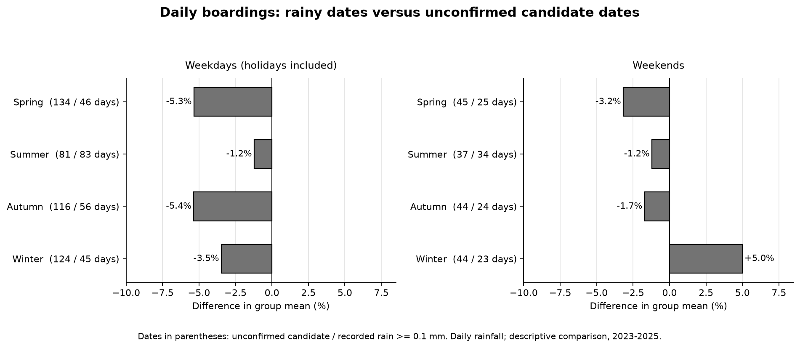
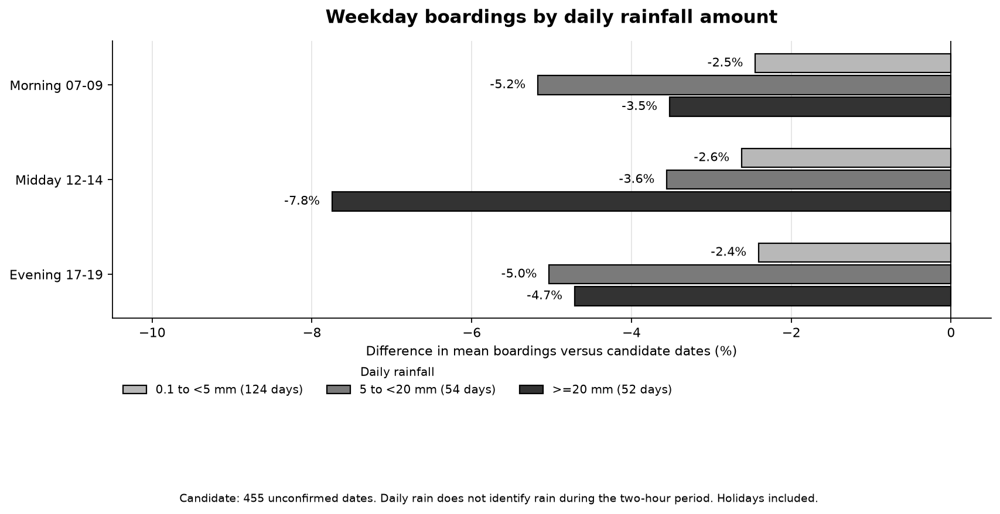

# 서울 지하철 승차와 강수량: EDA 상세 과정 및 결과

## 1. 분석 질문과 범위

이 탐색은 비가 기록된 날에 서울 지하철의 승차량이 어떻게 나타나는지 살펴보는 2차 중간 단계입니다. 다음 질문을 중심으로 자료를 정리했습니다.

1. 2023–2025년에 공통으로 관측된 역·호선의 승차량은 평일과 주말에 어떻게 다른가요?
2. 일강수 기록일과 미확인 무강수 후보일의 승차량 차이가 계절과 연도별로 어떻게 나타나나요?
3. 평일의 일강수 구간을 나누면 출근·낮·퇴근 시간대 승차량에는 어떤 차이가 나타나나요?
4. 평균뿐 아니라 중앙값과 사분위수를 비교했을 때 살펴볼 날짜가 있나요?

이 문서는 **기존 2차 분석과 2026년 11월 26일에 추가 실행한 기초 탐색**을 설명합니다. 기상청 일별 기록을 이용한 집단 비교이며, 시간별 기상자료를 승차 시간에 맞춘 분석이나 최종 모형 결과는 포함하지 않았습니다.

## 2. 자료와 처리 과정

### 2.1 자료 출처와 관측 단위

| 자료 | 내용 | 기간·단위 |
| --- | --- | --- |
| [서울 열린데이터광장](https://data.seoul.go.kr/dataList/OA-12921/F/1/datasetView.do) | 서울교통공사 역별 일별 시간대별 승하차 인원 | 2023–2025년, 날짜·역·호선·승하차·시간대 |
| [기상자료개방포털](https://data.kma.go.kr/data/grnd/selectAsosRltmList.do?pgmNo=36) | 종관기상관측(ASOS), 서울 지점 108의 일별 자료 | 2023–2025년, 날짜별 일강수량·평균기온 등 |

승차 건수는 통행 시 발생한 승차의 합계이며 사람 수와 같지 않습니다. 공통 비교 집단은 3개 연도에 승차와 하차 기록이 모두 확인되는 **272개 역·호선 코드 조합**입니다. 서울의 모든 지하철역이나 모든 교통수단을 대표한다고 가정하지 않았습니다. 원자료와 내려받기 정보는 [원자료 폴더](../02_interim_report/data/raw/)와 [지하철 수집 기록](../02_interim_report/data/raw/subway/provenance.json)에 있습니다.

### 2.2 원자료 점검과 변환

| 연도 | 원본 행 | 완전히 빈 행 | 유효 행 | 날짜 | 역·호선 코드 조합 |
| --- | ---: | ---: | ---: | ---: | ---: |
| 2023 | 199,270 | 0 | 199,270 | 365 | 282 |
| 2024 | 199,410 | 0 | 199,410 | 366 | 273 |
| 2025 | 199,424 | 134 | 199,290 | 365 | 273 |

연도별 열 이름과 문자 인코딩을 확인하고 시간대별 열을 날짜·역·호선·승하차·시간대 단위의 행으로 정리했습니다. 2025년의 완전히 빈 행 134개를 제외했으며, 원자료의 후보 키 중복 행은 연도별로 모두 0개였습니다. 확인 결과는 [지하철 원자료 점검표](../02_interim_report/results/interim/tables/subway_source_audit.csv)에 있습니다.

공통 집단에 대해 하루 06–24시의 18개 시간대 승차 건수를 합산했습니다. 추가 탐색에서는 1,096일 × 18시간인 **19,728개** 날짜·시간대 행이 존재하고, 날짜별 18시간 승차 합계가 기존 일별 승차 합계와 일치하는지 확인했습니다. 공통 집단과 전체 집단의 승차·하차 합계도 변환 전후에 보존되었습니다. [변환 합계 대조표](../02_interim_report/results/interim/tables/reshape_validation.csv)와 [추가 분석 점검 기록](../02_interim_report/results/interim/enriched_eda/analysis_audit.json)을 참고해 주시기 바랍니다.

### 2.3 일별 기상자료 결합

서울 기상 관측소의 일별 자료는 1,096일이며 기간 내 빠진 날짜와 일별 승차자료에 결합되지 않은 날짜는 각각 0일이었습니다. 날짜를 기준으로 결합할 때 시간대 집계 행 수는 87,680개로 유지되었고, 승하차 합계도 결합 전후에 같았습니다. 이 87,680개 행은 공통·전체 집단과 승차·하차를 모두 포함한 결합 점검 수치이며, 위의 공통 집단 승차 19,728행과 기준이 다릅니다. 자세한 수치는 [기상 결합 점검 기록](../02_interim_report/results/interim/weather_merge_audit.json)에 있습니다.

## 3. 강수 기록과 비교집단 정의

일강수량 빈칸을 숫자 0으로 바꾸지 않았습니다. 강수량이 비어 있고 강수 계속시간도 비어 있으며, 평균기온이 있고 기상현상 기사에 정해 둔 강수 관련 표현이 없는 경우를 **미확인 무강수 후보**로 분류했습니다. 이 보조 조건은 실제 무강수의 증명이 아닙니다. 정확한 조건은 [기상자료 처리 코드](../02_interim_report/src/weather.py)에 있습니다.

| 구분 | 조건 | 날짜 수 | 이 문서의 주요 비교 |
| --- | --- | ---: | --- |
| 미확인 무강수 후보 | 강수량 빈칸 및 위의 보조 조건 충족 | 625 | 기준 집단으로 사용 |
| 강수 기록일 | 일강수량 0.1mm 이상 | 336 | 후보일과 비교 |
| 기록된 0.0mm | 일강수량에 0.0이 기재 | 132 | 별도로 보존 |
| 그 밖의 미확인 | 빈칸 중 후보 조건 미충족 등 | 3 | 주요 비교에서 제외 |

원자료에서 일강수량이 빈칸인 날짜는 총 628일이며, 이 중 625일이 후보이고 3일은 별도 미확인입니다. 0.0mm 132일 중 131일에는 강수 계속시간 값이 기록되어 있었습니다. 이 점검은 0.0과 빈칸을 단순히 같은 무강수로 취급하지 않은 이유입니다. [교차 점검표](../02_interim_report/results/interim/tables/rain_vs_duration_crosscheck.csv)에서 확인할 수 있습니다.

평일은 월요일부터 금요일이며 **공휴일을 제외하지 않았습니다**. 주말은 토요일과 일요일입니다. 계절은 봄 3–5월, 여름 6–8월, 가을 9–11월, 겨울 12–2월로 구분했습니다. 겨울 자료는 해당 월들을 한 집단으로 묶은 것입니다.

## 4. 기초 탐색 결과

### 4.1 평일·주말 및 일별 분포

단위는 하루 06–24시 평균 또는 중앙값 승차 건수입니다.

| 요일 구분 | 일강수 구분 | 날짜 수 | 평균 | 중앙값 | 제1사분위 | 제3사분위 |
| --- | --- | ---: | ---: | ---: | ---: | ---: |
| 평일 | 미확인 후보 | 455 | 4,813,381 | 4,938,576 | 4,762,033 | 5,079,922 |
| 평일 | 0.1mm 이상 | 230 | 4,623,082 | 4,795,286 | 4,610,502 | 4,961,163 |
| 주말 | 미확인 후보 | 170 | 3,132,742 | 2,981,060 | 2,649,679 | 3,689,841 |
| 주말 | 0.1mm 이상 | 106 | 3,102,038 | 3,196,060 | 2,602,524 | 3,551,262 |

평일 강수 기록일의 평균은 후보일보다 약 4.0% 낮았습니다. 주말은 강수 기록일의 평균이 후보일보다 약간 낮지만 중앙값은 높았습니다. 평균과 중앙값은 분포의 서로 다른 특성을 보여 주므로 어느 하나만으로 전체 날짜의 변화를 설명하지 않았습니다. 원표: [일별 분포](../02_interim_report/results/interim/enriched_eda/daily_distribution.csv), [강수·요일 기초 통계](../02_interim_report/results/interim/tables/precip_weekend_descriptive.csv).

각 집단에서 제1사분위에서 사분위 범위의 1.5배를 뺀 값보다 낮은 날짜는 평일 후보 27일, 평일 강수 기록일 21일이었습니다. 이 기준은 추가 확인 대상을 고르는 방법일 뿐이며, 낮은 값이 곧 자료 오류나 운행 장애라는 뜻은 아닙니다. [낮은 값 예시](../02_interim_report/results/interim/enriched_eda/low_tail_candidates.csv)는 각 집단의 승차량이 낮은 날짜 **3개씩만** 보여 주므로 전체 후보 목록은 아닙니다.

### 4.2 계절·요일별 비교

차이는 `(강수 기록일 평균 ÷ 후보일 평균 - 1) × 100`으로 계산했습니다. 평균은 하루 승차 건수이며 날짜 수를 함께 표시했습니다.

| 계절 | 요일 | 후보 날짜 | 강수 날짜 | 후보 평균 | 강수 평균 | 차이 |
| --- | --- | ---: | ---: | ---: | ---: | ---: |
| 봄 | 평일 | 134 | 46 | 4,949,003 | 4,684,303 | -5.3% |
| 봄 | 주말 | 45 | 25 | 3,263,462 | 3,159,903 | -3.2% |
| 여름 | 평일 | 81 | 83 | 4,717,177 | 4,659,500 | -1.2% |
| 여름 | 주말 | 37 | 34 | 3,008,957 | 2,972,480 | -1.2% |
| 가을 | 평일 | 116 | 56 | 4,857,210 | 4,596,962 | -5.4% |
| 가을 | 주말 | 44 | 24 | 3,263,294 | 3,207,438 | -1.7% |
| 겨울 | 평일 | 124 | 45 | 4,688,664 | 4,525,833 | -3.5% |
| 겨울 | 주말 | 44 | 23 | 2,972,592 | 3,120,680 | +5.0% |



평일의 단순 평균 차이는 봄과 가을에 여름보다 크게 나타났습니다. 겨울 주말은 강수 기록일 평균이 높았지만 각 집단은 44일과 23일이며 구성도 다릅니다. 계절·요일로 나눈 결과만으로 공휴일과 개별 날짜의 차이를 제거했다고 볼 수 없습니다. 원표: [계절별 비교](../02_interim_report/results/interim/enriched_eda/seasonal_daily_comparison.csv), [계절별 집단 통계](../02_interim_report/results/interim/enriched_eda/seasonal_daily_groups.csv).

### 4.3 연도별 비교

| 연도 | 요일 | 후보 날짜 | 강수 날짜 | 후보 평균 | 강수 평균 | 차이 |
| --- | --- | ---: | ---: | ---: | ---: | ---: |
| 2023 | 평일 | 153 | 76 | 4,688,887 | 4,611,180 | -1.7% |
| 2023 | 주말 | 62 | 33 | 3,070,397 | 2,845,908 | -7.3% |
| 2024 | 평일 | 149 | 78 | 4,823,873 | 4,630,128 | -4.0% |
| 2024 | 주말 | 57 | 32 | 3,128,637 | 3,130,407 | +0.1% |
| 2025 | 평일 | 153 | 76 | 4,927,657 | 4,627,751 | -6.1% |
| 2025 | 주말 | 51 | 41 | 3,213,121 | 3,286,050 | +2.3% |

연도별 집단 구성과 공휴일 분포가 다르므로 이 표만으로 강수의 영향이 해마다 커졌다고 결론 내리지 않았습니다. 원표: [연도별 비교](../02_interim_report/results/interim/enriched_eda/yearly_daily_comparison.csv).

### 4.4 평일의 일강수 구간과 시간대

한 시간대의 수치는 다음 두 시간의 승차 건수 합계입니다.

- 출근: 07–08시와 08–09시
- 낮: 12–13시와 13–14시
- 퇴근: 17–18시와 18–19시

평일 후보일은 455일입니다. 강수 구간별 날짜 수는 0.1mm 이상 5mm 미만 124일, 5mm 이상 20mm 미만 54일, 20mm 이상 52일입니다. 0.0mm와 그 밖의 미확인은 이 비교에서 제외했습니다.

| 시간대 | 후보 평균 승차 | 0.1–5mm 미만 차이 | 5–20mm 미만 차이 | 20mm 이상 차이 |
| --- | ---: | ---: | ---: | ---: |
| 출근 07–09시 | 853,155 | -2.5% | -5.2% | -3.5% |
| 낮 12–14시 | 412,624 | -2.6% | -3.6% | -7.8% |
| 퇴근 17–19시 | 1,020,231 | -2.4% | -5.0% | -4.7% |



이 구간은 **하루 전체 일강수량**을 기준으로 나눴습니다. 하루에 20mm 이상이 기록되었더라도 그 비가 출근·낮·퇴근의 해당 두 시간에 왔다는 뜻은 아닙니다. 계절과 공휴일 등의 구성이 다를 수 있으므로 표의 차이를 시간대별 강수 효과로 단정하지 않았습니다. 원표: [시간대별 통계](../02_interim_report/results/interim/enriched_eda/weekday_period_by_daily_rain.csv), [날짜·시간대별 집계](../02_interim_report/results/interim/enriched_eda/daily_period_observations.csv). 1,096일 × 3개 시간대인 3,288개 행이 있습니다.

기존 2차 분석에서는 하루 강수 기록을 기준으로 1시간별 승차 패턴도 비교했습니다. [시간대별 패턴 그림](../02_interim_report/results/interim/figures/03_hourly_by_daily_precipitation.png)과 [원표](../02_interim_report/results/interim/tables/hourly_profile.csv)를 확인할 수 있습니다. 이 그림도 시간별 강수량을 결합한 결과는 아닙니다.

## 5. 실행과 검증

기본 분석에서는 원자료의 후보 키 중복, 기상자료 미결합, 강수 빈칸의 0 대체 방지, 연도별 시간대 이름을 검사하는 검증 4개가 통과했습니다. 추가 분석에서는 강수 구간 경계, 계절·시간대 정의, 두 시간 합계, 분포 대조에 관한 검증 4개가 통과했습니다.

| 기록 | 확인할 내용 |
| --- | --- |
| [기본 분석 실행 로그](../02_interim_report/results/interim/codespaces_interim_run.txt) | 자료 범위, 원자료·결합 점검, 강수 구분 |
| [기본 분석 검증 결과](../02_interim_report/results/interim/tests.txt) | 기본 검증 4개 |
| [추가 분석 실행 로그](../02_interim_report/results/interim/enriched_eda/execution_log.txt) | 추가 분석 실행 시각, 표본 수, 분석 범위 |
| [추가 분석 검증 결과](../02_interim_report/results/interim/enriched_eda/tests.txt) | 추가 검증 4개 |
| [추가 분석 실행 화면](../02_interim_report/results/interim/captures/07_enriched_run.jpg), [검증 화면](../02_interim_report/results/interim/captures/08_enriched_tests.jpg) | 실제 Codespaces 실행 내용 |
| [계절별 결과 화면](../02_interim_report/results/interim/captures/09_enriched_season.jpg), [시간대별 결과 화면](../02_interim_report/results/interim/captures/10_enriched_period.jpg) | 실제 출력 예시 |

그림 2개는 기존 결과 CSV를 읽어 이 EDA 폴더에 새로 생성했습니다. 실행 결과 자체와 그림 작성 과정을 구별하기 위해 원본 표와 그림 코드를 각각 연결했습니다.

## 6. 재현 방법

저장소의 `data-analysis-project` 폴더에서 Python 환경을 준비한 다음 실행합니다. `02_interim_report`의 원자료와 기존 결과 파일이 함께 있어야 합니다.

```bash
python -m venv .venv
# macOS/Linux: source .venv/bin/activate
# Windows PowerShell: ./.venv/Scripts/Activate.ps1
python -m pip install -r 02_interim_report/requirements.txt

cd 02_interim_report
python scripts/run_interim.py
python scripts/build_hourly_subway_input.py
python scripts/show_interim_hourly_quality.py
python scripts/run_interim_enrichment.py
python -m unittest discover -s tests -p test_interim_integrity.py -v
python -m unittest discover -s tests -p test_interim_enrichment.py -v
cd ..
python EDA/create_eda_figures.py
```

재실행하면 기존 `results/interim/`의 결과표와 추가 분석의 실행 시각 기록이 새로 쓰일 수 있습니다. 기존 실행 기록을 보존하려면 저장소 복사본에서 재현해 주시기 바랍니다. 일별 입력과 시간대별 승차 합계를 대조하는 코드는 [추가 분석 코드](../02_interim_report/scripts/run_interim_enrichment.py)에 있으며, 운영체제의 줄바꿈 차이로 CSV 파일 해시가 달라질 수 있습니다.

## 7. 해석상 한계와 이후 단계

- 관측된 날짜 집단은 무작위로 배정되지 않았고, 강수 여부 이외의 계절·공휴일·요일 등이 다를 수 있습니다.
- 후보일은 무강수가 확인된 날짜가 아닙니다. 강수 관측값의 빈칸과 0.0을 명확히 구분했습니다.
- 2차 비교는 일강수 기록에 근거합니다. 실제 같은 시간의 비와 지하철 이용을 비교하는 결론은 여기에서 내릴 수 없습니다.
- 다른 교통수단의 이용량이나 개인의 휴가·출근 선택 자료가 없어 이동 수단 전환, 선호, 이동 목적을 확인할 수 없습니다.
- 이후 단계에서는 시간별 기상자료의 시각 정렬을 확인하고, 공휴일과 달력 조건을 고려한 비교를 검토할 계획입니다. 이 문서에 그 최종 결과를 미리 제시하지 않았습니다.
