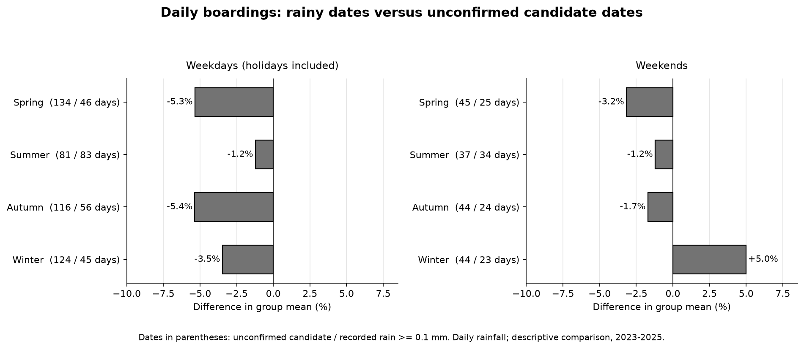

# 서울 지하철 승차와 강수량 EDA 요약

## 분석 목적과 자료

비가 기록된 날의 지하철 승차량이 비교 후보일과 어떻게 다른지 살펴보고, 그 양상이 계절·요일과 시간대에 따라 달라지는지 기초적으로 확인했습니다. 이는 비교가 필요한 지점을 찾기 위한 2차 중간 단계의 탐색입니다.

- **기간:** 2023년 1월 1일–2025년 12월 31일, 총 1,096일
- **지하철:** 3개 연도에 공통으로 확인된 272개 역·호선 코드 조합, 매일 06–24시 승차 건수
- **기상:** 기상청 서울(108) 관측소의 일별 자료. 기온, 일강수량, 강수 계속시간, 기상현상 기록 확인
- **관측 단위:** 일별 승차 합계와 시간대별 승차 건수. 승차 건수는 고유 이용자 수가 아닙니다.

원자료는 [서울 열린데이터광장](https://data.seoul.go.kr/dataList/OA-12921/F/1/datasetView.do)과 [기상자료개방포털](https://data.kma.go.kr/data/grnd/selectAsosRltmList.do?pgmNo=36)에서 확보했습니다. [자료 처리와 표본 정의](EDA_상세_과정_및_결과.md#2-자료와-처리-과정)를 참고해 주시기 바랍니다.

## 강수 기록의 구분

| 일강수 기록과 보조 정보 | 날짜 수 | 처리 |
| --- | ---: | --- |
| 0.1mm 이상 | 336일 | 강수 기록일로 분류 |
| 강수량·강수 계속시간이 비어 있고, 보조 조건을 충족 | 625일 | 미확인 무강수 후보로 분류 |
| 0.0mm가 기록됨 | 132일 | 별도 집단으로 보존 |
| 그 밖의 미확인 기록 | 3일 | 주요 비교에서 제외 |

빈칸을 0으로 바꾸지 않았습니다. 후보일도 실제 무강수일인지 확정할 수 없으며, 0.0mm 기록일과 합치지 않았습니다. 표의 기준과 보조 조건은 [상세 문서](EDA_상세_과정_및_결과.md#3-강수-기록과-비교집단-정의)에 설명했습니다.

## 주요 탐색 결과

1. **계절별 차이:** 평일 강수 기록일의 일평균 승차량은 같은 계절의 후보일보다 봄에 5.3%, 여름에 1.2%, 가을에 5.4%, 겨울에 3.5% 낮았습니다. 두 집단은 서로 다른 날짜입니다.
2. **시간대별 차이:** 일강수 20mm 이상이 기록된 평일의 평균 승차량은 후보일 대비 출근 07–09시에 3.5%, 낮 12–14시에 7.8%, 퇴근 17–19시에 4.7% 낮았습니다. 하루 강수량은 해당 두 시간에 비가 왔음을 뜻하지 않습니다.
3. **승차량 분포:** 평일 후보일과 강수 기록일의 일별 승차 중앙값은 각각 약 494만 건과 480만 건이었습니다. 주말에는 평균과 중앙값의 비교 방향이 달라 분포를 함께 볼 필요가 있었습니다.

그림의 비율은 `(강수 기록일 평균 ÷ 후보일 평균 - 1) × 100`입니다. 계절·요일 구분별 후보일과 강수 기록일의 날짜 수는 [상세 결과](EDA_상세_과정_및_결과.md#4-기초-탐색-결과)에서 확인할 수 있습니다.

## 확인한 한계와 다음 단계

- 평일은 월요일부터 금요일까지이며 공휴일이 포함됩니다. 두 비교집단의 계절·요일·공휴일 구성도 서로 다를 수 있습니다.
- 하루 강수량으로는 출근이나 퇴근 시간에 실제로 비가 왔는지 알 수 없습니다. 평균 차이를 강수의 인과 효과로 해석할 수 없습니다.
- 버스·택시·자차 등 다른 수단의 이용자료가 없어 교통수단 전환이나 선호를 확인할 수 없습니다.
- 이후에는 실제 시간별 기상자료와 승차 시간대를 맞추고, 공휴일과 달력 조건을 고려한 비교를 검토할 계획입니다. 이 문서에는 이후 단계의 최종 결과를 포함하지 않았습니다.

분석 과정, 세부 표본 수, 결과표, 검증 및 실제 실행 화면은 [EDA 상세 과정 및 결과](EDA_상세_과정_및_결과.md)에 정리했습니다.
